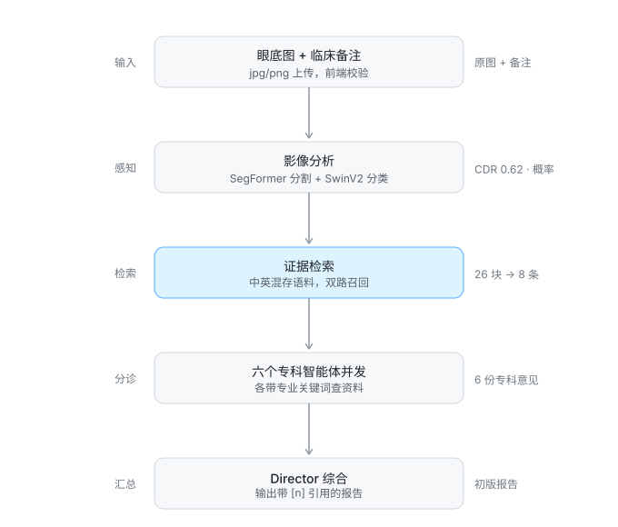
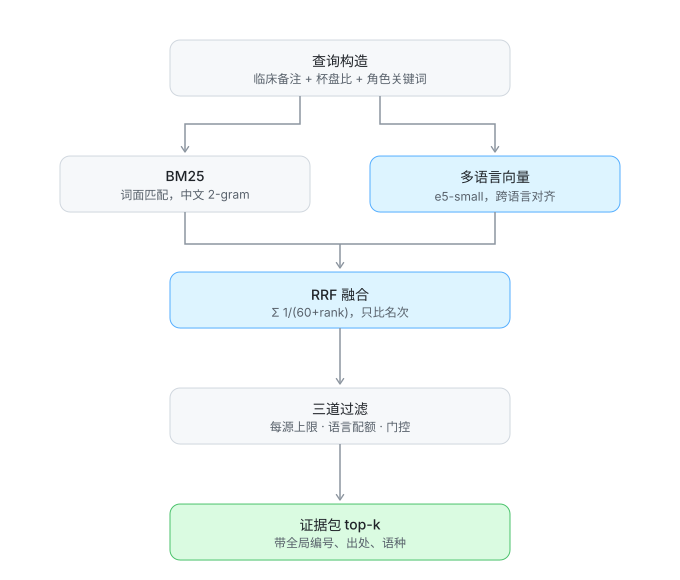
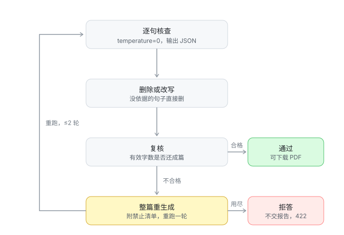

# OcuPanel

> 多智能体眼科报告系统 · 每个结论可追溯，无据即拒答

一个模块化框架：用**视觉后端**从眼底图像中提取可验证的病灶特征，再交给**角色化的大语言模型智能体**各自撰写子报告，最后由一个 *Director* 智能体综合成一份简洁、有临床依据的青光眼诊断报告。核心思想是让每个智能体只聚焦一个窄领域的临床角色，模拟真实的多学科会诊。

本项目基于 Philip Liu 等人的 *Multi-Agent Diagnosis using Multimodal Large Language Models*（MIPR 2025，引用见文末）改造而来，在原仓库基础上完成了以下本地化改造：

1. 前端从原生 HTML/JS 重写为 **React + Vite**（旧版原生文件已随重构删除，仓库只保留 React 版本）；
2. 后端（FastAPI）**直接托管前端构建产物**，一条命令即可同时启动 API 和页面；
3. **多用户账号体系**：SQLite 存账户、会话与报告，所有数据按 `user_id` 隔离；每人在「个人设置」里填自己的 LLM API Key（服务端 Fernet 加密），**代码中不再硬编码任何密钥**；
4. 后端不再把 LLM 配置写死在代码里：服务器默认值走环境变量，用户可在界面上覆盖模型名与接口地址。

---

## 方法流程

1. **视觉预处理**
   - **分类器（SwinV2）** → 青光眼概率 *p*，分箱为「无青光眼 / 可能 / 较可能 / 检测到青光眼」。
   - **分割器（SegFormer）** → 视杯与视盘掩码 → 杯盘比（CDR）。
2. **核心提示词**：用自然语言概括 *p* 与 CDR，可附加临床医生备注。
3. **角色生成**：元提示词让 GPT-4.1 列出相关临床角色（眼科医生、验光师、药师等）。
4. **角色化子报告**：每个角色拿到核心提示词 + 本专业的窄指令，撰写聚焦的子报告。
5. **Director 综合**：另一个 GPT-4.1 实例合并全部子报告，消解轻微冲突，产出唯一一份诊断报告。
6. **引用校验（第 7 个智能体）**：逐句核对 `[n]` 是否真的支撑该句，不支撑的打回重写，再复核一轮。
7. **输出与界面**：最终报告、概率、CDR、子报告、证据包、校验结果返回客户端，支持交互式问答与 PDF 导出。

<p align="center">
  
</p>

上图对应 `backend/api/report.py` 的 `generate_content`。第三步的检索与第五步的综合之间还有一道引用校验（见下文「引用校验」），它不在主链路上画出来，是因为它既可能让流程回头（重生成），也可能让流程关门（拒答）。六个专科互不依赖，用 `ThreadPoolExecutor` 并发——串行时整条链路要 8 分钟以上，并发后约等于最慢的那一次。

---

## 核心贡献

| # | 贡献 | 意义 |
|---|---|---|
| 1 | **多智能体推理**：眼科医生、验光师、药师等角色 + Director 智能体 | 降低幻觉，反映真实临床协作 |
| 2 | **CAD ⇄ LLM 紧耦合**：SwinV2 分类器（青光眼概率）+ SegFormer 分割器（视杯/视盘掩码） | 让语言输出锚定在可验证的图像特征（如 CDR）上 |
| 3 | **浏览器客户端** | 支持交互式问答与 PDF 报告下载，由 FastAPI 直接托管 |
| 4 | **引用校验智能体**：第 7 个 Agent 逐句核对引用，不支撑的句子打回重写 | 把「看起来合理」的话挡在报告之外，幻觉可被定位、可被修正 |

---

## 目录结构

```
OcuPanel/
├── backend/                    # FastAPI 后端（同时托管前端页面）
│   ├── api/                    #   REST 路由：account.py（注册/登录/LLM 配置）
│   │                           #             chat.py（会话与问答）、report.py（报告/取图）
│   ├── schemas/                #   Pydantic 请求/响应模型
│   ├── classifier/             #   SwinV2 青光眼分类器
│   ├── segmenter/              #   SegFormer 视杯/视盘分割 + CDR 计算
│   ├── main.py                 #   应用入口（路由 / CORS / 静态托管 / 启动）
│   ├── storage.py              #   SQLite 数据层（账户/配置/会话/消息/报告）+ Key 加密
│   ├── auth.py                 #   登录态（令牌签发、校验、注销）
│   ├── config.py               #   环境变量集中管理
│   ├── paths.py                #   output/ 与 img_store/ 路径解析
│   ├── report_generator.py     #   报告生成 / Director 合成 / PDF 导出
│   ├── retrieval.py            #   证据检索（BM25 + 多语言向量 + RRF 融合）
│   ├── verifier.py             #   引用校验智能体（核查 → 打回重写 → 复核）
│   ├── knowledge/corpus/       #   知识语料（示例，正式使用需换权威指南）
│   ├── check_llm.py            #   LLM 连通性自检
│   ├── requirements.txt        #   精确锁定的依赖
│   └── .env.example            #   环境变量模板
├── frontend/                   # React + Vite 前端
│   └── src/
│       ├── api.js              #   接口封装（统一带 Bearer 令牌，401 自动退回登录）
│       ├── App.jsx             #   全局状态与业务逻辑
│       └── components/         #   LoginPage / Sidebar / WelcomeView / ChatView
│                               #   ReportView / SettingsView / EvidenceList 等
├── tools/shot.py               #   无头 Chrome 截图脚本（CDP，仅标准库）
├── samples/                    # 测试样本
│   ├── fundus_right_eye.png    #   AI 合成的右眼眼底照
│   ├── clinical_note.txt       #   配套中文临床记录
│   ├── segmentation_overlay.png#   实际分割结果（粉=视盘，绿=视杯）
│   ├── report_sample_en.md     #   英文报告样式参考
│   └── report_sample_zh.pdf    #   实际生成的中文 PDF 样例
├── docs/diagrams/              #   本文档用的流程图（纯 SVG，无外部依赖）
│   ├── pipeline.svg            #     主链路五阶段
│   ├── citation-verifier.svg   #     第 7 智能体的校验闭环
│   └── rag-hybrid.svg          #     混合检索内部结构
└── README.md
```

### 数据存在哪

没有引入 ORM，也没有额外的数据库服务，就是 `backend/medchat.db` 一个 SQLite 文件（首次启动自动建表）：

| 表 | 内容 | 说明 |
|---|---|---|
| `users` | 用户名、密码哈希、显示名 | PBKDF2-HMAC-SHA256，600k 迭代，每用户随机盐 |
| `llm_configs` | 每人的 Base URL / 模型 / **加密后的 API Key** | Fernet 对称加密，密钥是 `.env` 的 `MEDCHAT_SECRET_KEY` |
| `conversations` | 会话标题、创建/更新时间 | 按 `user_id` 隔离 |
| `messages` | 对话逐条记录（含报告 meta） | 报告消息的 `meta` 里存分割图名、证据、校验结果 |
| `reports` | 报告留痕 | 便于查"这份报告是什么时候、用哪个模型生成的" |

几个刻意的选择：

- **每个用户用自己的 Key。** 代码里不写死 key，也不回退到服务器的 `OPENAI_API_KEY`——没配就返回 409，而不是偷偷用别人的额度。
- **Key 不在界面回显明文。** 只给 `sk-xxx...abcd` 形式的掩码，保存时留空表示沿用旧值。
- **越权统一返回 404。** 访问别人的会话返回「会话不存在」而不是 403，不泄露"这个 id 存在"。
- **`.gitignore` 已排除 `*.db`。** 这个文件含账户与密文 Key，不能进版本库。

> ⚠️ `MEDCHAT_SECRET_KEY` 丢了，所有用户已存的 Key 就解不开，只能重新填写。首次启动会自动生成并写回 `.env`，请自行备份。

---

## 快速开始

### 模式一：单服务（推荐）

FastAPI 同时提供 API 和页面，只需一条命令。

```bash
# 1. 装后端依赖
cd backend
python -m venv ../.venv
../.venv/Scripts/python.exe -m pip install --upgrade pip

# requirements.txt 锁定的 torch==2.7.0 是 CUDA 版（约 2.5GB），
# 纯 CPU 推理建议先剔除该行，再从 PyTorch CPU 源安装：
../.venv/Scripts/python.exe -m pip install --index-url https://pypi.org/simple -r <(grep -v '^torch==' requirements.txt)
../.venv/Scripts/python.exe -m pip install --index-url https://download.pytorch.org/whl/cpu "torch==2.7.0+cpu"

# 2. 构建前端
cd ../frontend
npm install
npm run build          # 产物输出到 frontend/dist

# 3. 配置并启动
cd ../backend
cp .env.example .env    # 至少填入 OPENAI_API_KEY
../.venv/Scripts/python.exe main.py
```

浏览器打开 <http://127.0.0.1:8000> —— 页面和 API 都在这里。

> Windows 的 Git Bash 不支持 `<(...)` 进程替换，可先执行
> `grep -v '^torch==' requirements.txt > req-norch.txt`，再把 `-r` 指向该文件。

### 模式二：前后端分离（开发用）

前端用 Vite dev server（热更新），`/api` 自动代理到后端，同样不需要任何配置。

```bash
# 终端 1：后端
cd backend
../.venv/Scripts/python.exe main.py

# 终端 2：前端
cd frontend
npm run dev
```

浏览器打开 <http://127.0.0.1:5500>。

> ⚠️ **两个终端都要开着。** 模式二下页面在 5500、接口要转发到 8000；只起前端时页面能正常打开
> （纯静态），但一提交表单就会报 **`Internal Server Error`** —— 因为 Vite 代理找不到后端，
> 直接回了 `500` 空响应。看到这个错误先确认终端 1 的 FastAPI 是否还在运行。

### 两种模式对比

| | 单服务 | 前后端分离 |
|---|---|---|
| 访问地址 | http://127.0.0.1:8000 | http://127.0.0.1:5500 |
| 需要几个进程 | 1 | 2 |
| 前端热更新 | ❌（改完要 `npm run build`） | ✅ |
| 跨域 | 无（同源） | 无（Vite 代理） |
| 适用场景 | 演示、部署、给他人使用 | 日常开发 |

> `frontend/dist` 不存在时，后端自动降级为纯 API 模式并打印提示，不会报错。

---

## 环境变量

### 后端（`backend/.env`）

| 变量 | 默认值 | 说明 |
|---|---|---|
| `OPENAI_API_KEY` | 无 | OpenAI 兼容接口的密钥。留空则跳过 LLM 调用，视觉流水线仍可运行 |
| `OPENAI_MODEL` | `gpt-4.1` | 模型 ID，可换成任何 OpenAI 兼容模型（如 DeepSeek 用 `deepseek-flash`，旧的 `deepseek-chat` 已下线） |
| `OPENAI_BASE_URL` | 官方 OpenAI | 设为第三方/本地端点即可接入，如 `https://api.deepseek.com` |
| `REPORT_LANGUAGE` | `zh` | 报告语言，`zh` 中文 / `en` 英文；只影响 LLM 输出与 PDF 文案 |
| `REPORT_FONT_PATH` | 自动探测 | 中文 PDF 字体；默认按 `simhei.ttf` → `Deng.ttf` → `msyh.ttc` → `simsun.ttc` 顺序找，找不到退回内置字体（中文会缺字） |
| `LLM_TIMEOUT` | `120` | 单次 LLM 请求超时（秒） |
| `LLM_MAX_RETRIES` | `1` | LLM 请求失败重试次数 |
| `LLM_DISABLE_THINKING` | `1` | 对 DeepSeek 端点关闭 thinking 模式，单请求耗时从 ~15s 降到 ~2s；设 `0` 恢复 |
| `HOST` | `127.0.0.1` | 服务监听地址 |
| `PORT` | `8000` | 服务监听端口 |
| `RELOAD` | `0` | 热重载开关。开发时设 `1`；**改文件名/移动目录时务必关掉**，否则 reloader 可能在中间态重启导致 500 |
| `CORS_ORIGINS` | `http://127.0.0.1:5500,http://localhost:5500` | 跨域白名单；单服务模式同源，不需要 CORS |
| `FRONTEND_DIST` | `../frontend/dist` | 前端构建产物目录；不存在则进入纯 API 模式 |
| `HF_ENDPOINT` | 无 | HuggingFace 镜像，`huggingface.co` 不通时设为 `https://hf-mirror.com` |

### 前端（`frontend/.env`，一般不用配）

| 变量 | 默认值 | 说明 |
|---|---|---|
| `VITE_API_BASE_URL` | 空（同源相对路径） | 只有后端在别的地址/端口时才需要设置 |
| `VITE_DEBUG` | `1`（开启） | 右下角调试抽屉：每次请求的 URL、状态码、耗时、请求体、响应体 |

---

## API 说明

除注册/登录外，**所有接口都要求 `Authorization: Bearer <token>`**，未带或失效统一返回 `401`。

### 账户

| 方法 | 路径 | 说明 |
|---|---|---|
| POST | `/api/account/register` | 注册并直接登录，返回 `{user, token}` |
| POST | `/api/account/login` | 登录；用户名或密码错都只回「用户名或密码错误」，防枚举 |
| POST | `/api/account/logout` | 注销当前令牌 |
| GET | `/api/account/me` | 当前用户 + 已配置的 LLM（Key 为掩码） |
| GET | `/api/account/llm-presets` | 内置服务商预设与服务器默认值 |
| PUT | `/api/account/llm` | 保存配置；`api_key` 留空表示沿用已存的 |
| POST | `/api/account/llm/test` | 测试连通，**不落库** |
| DELETE | `/api/account/llm` | 清除配置 |
| GET | `/api/account/usage` | 对话数 / 报告数 / 被拒答次数 |

### 会话与问答

| 方法 | 路径 | 说明 |
|---|---|---|
| GET | `/api/chat/conversations` | 会话列表（只含自己的） |
| POST | `/api/chat/conversations` | 新建会话 |
| GET | `/api/chat/conversations/{id}` | 会话详情 + 全部消息 |
| PATCH | `/api/chat/conversations/{id}` | 重命名 |
| DELETE | `/api/chat/conversations/{id}` | 删除（连带消息） |
| POST | `/api/chat/conversations/{id}/messages` | 发消息，返回助手回复 |

### 报告

| 方法 | 路径 | 说明 |
|---|---|---|
| POST | `/api/generate-report/` | 上传图像 + 备注，直接返回 PDF 文件（校验未通过返回 `422`） |
| POST | `/api/generate-report-content/` | 上传图像 + 备注，返回 JSON（`summary` / `cup_to_disc_ratio` / `img_name` / `evidence` / `verification`） |
| GET | `/api/get-report-image/{img_name}` | 取回叠加了分割掩膜的眼底图（文件名有白名单校验，防路径穿越） |

报告两个接口的公共表单字段：

| 字段 | 类型 | 说明 |
|---|---|---|
| `file` | File | 眼底图像（`.jpg` / `.jpeg` / `.png`） |
| `note` | Text | 临床备注（可选） |
| `conversation_id` | Text | 关联到哪个会话（可选，缺省则新建） |

未配置 LLM 时这两个接口返回 `409`，提示去个人设置填写。

接口文档：<http://127.0.0.1:8000/docs>（Swagger UI）、<http://127.0.0.1:8000/redoc>（ReDoc）。

示例：

```bash
TOKEN=$(curl -s -X POST http://127.0.0.1:8000/api/account/register \
  -H 'Content-Type: application/json' \
  -d '{"username":"doctor01","password":"pass1234"}' | jq -r .token)

curl -X POST http://127.0.0.1:8000/api/generate-report/ \
  -H "Authorization: Bearer $TOKEN" \
  -F "file=@fundus.jpg" \
  -F "note=IOP 24 mmHg OU" \
  -o diagnostic_report.pdf
```

---

## 知识检索（证据包）

报告不再只靠模型参数。每次生成前会做一次本地检索，把带出处的指南片段注入提示词：

```
病历 + 影像结论 → 各角色用自己的专业关键词检索 → 证据包（编号 + 出处）
                 → 注入提示词（要求句末标注 [n]）→ 报告正文带引用
                 → PDF 末尾附「参考资料」→ 前端展示证据卡片
```

检索内部结构：

<p align="center">
  
</p>

- **检索实现**：`backend/retrieval.py`，BM25（中文 2-gram）+ 多语言向量 + RRF 融合；语料按「小节 → 段落」两级切分。
- **按角色差异化**：`report_generator.ROLE_QUERY_HINTS` 给药师「禁忌/相互作用」、给技师「眼压测量/视野检查」等关键词加权，避免六个角色拿到同一批证据。
- **全局编号**：一条资料在所有角色提示词与最终报告里编号一致，Director 汇总不会串号。
- **语料位置**：`backend/knowledge/corpus/*.md`。**当前是示例语料**，正式使用请替换为权威指南原文。
- **开关**：`RAG_ENABLED=0` 退回纯模型生成，便于 A/B 对比；`RAG_TOP_K`、`RAG_MIN_SCORE` 控制召回数量与相对阈值。

### 中英语料混存（`RAG_MODE`）

语料可以中英混排，但**词面检索救不了跨语言**：中文查询在英文块里没有任何 token，实测零命中；只能靠缩写（OCT/RNFL）和数字漏网，而数字还会造成 1.0 的假命中。所以默认走多语言向量：

| 模式 | 中文查询 → 英文块 | 说明 |
|---|---|---|
| `bm25` | 永不命中 | 零依赖，只适合同一语料 |
| `vector` | 命中（余弦 0.82–0.84） | `intfloat/multilingual-e5-small`，AutoModel + mean pooling，不装 sentence-transformers |
| `hybrid`（默认） | 命中，且中文块排前 | 两路各宽召回，RRF 排名融合 |

实现在 `retrieval.py`，三个容易被忽略的细节：

1. **光有语义对齐不够，还要语言配额**（`RAG_LANG_QUOTA`）。中文块的相似度天然更高（0.93 vs 跨语言 0.85），top-4 会被中文块占满，英文块一个都排不上。配额给每种语言留 `k/语言数` 个位置。
2. **配额必须门控**（`RAG_LANG_GATE=0.89`）。否则「门诊预约流程」这种无关查询也会被硬塞两条英文块。不能逐项卡阈值——跨语言相关块（0.82–0.84）比同语言无关块（0.867）还低；看「最佳命中」才干净：相关查询 ≥0.918，无关查询 ≤0.867。
3. **每源最多 2 条**（`_diversify`）。同一文档的相邻段落本来就重复，随访主题 6 段全在 0.91–0.94，会把名额吃光。

融合用 RRF（`score = Σ 1/(60+rank)`）而不是分数加权：中英 BM25 的分数量纲不可比，向量分又是另一种，比名次最省事。

**关于 `score`**：hybrid 下它是融合相对分，不是余弦，直接当“相关度”显示会误导（实测某条真实余弦 0.81 却显示 0.37）。所以前端证据卡片只标命中方式（`词面` / `语义` / `混合`），三个原始分（`bm25` / `vector` / `rrf`）放在展开后的明细里。

**门控阈值是标定值，会让服务自己复核**：`RAG_LANG_GATE=0.89` 是在「当前 26 块语料 + e5-small」上量的（相关 0.918–0.939，无关 0.852–0.867，取两组的中性点）。换 `RAG_VECTOR_MODEL` 或语料大改后分布会漂移，否则门控要么常关（跨语言召回失效）、要么常开（无关查询被塞英文块）。

因此启动时会跑一次 `retrieval.selfcheck_gate()`：拿一条相关探针（语料首块的标题+小节，跟着语料自适应）和一条跨领域无关探针（挂号/停车费）各取最佳余弦，检查 gate 是否被夹在两者之间、且余量够不够。余量的判定不能用固定绝对值——探针间隔本身只有 0.03 量级时要求 0.05 余量等于永远判不过；实际取 `min(0.05, 间隔/4)`，即 gate 只需落在两簇中间那一半区间。失配或余量不足都写日志告警并给出建议值，**不自动改配置、也不挡启动**（自检跑在后台线程，顺带预热向量模型，首个请求不用再等加载）。

实测三种阈值下的行为：`0.89` → 通过；`0.95` → 判"跨语言配额永不触发"；`0.85` → 判"无关查询也会被塞英文块"。

升级路径：区分度不够时可换 `intfloat/multilingual-e5-base`（需 `pip install protobuf`）或 `bge-m3`，改 `RAG_VECTOR_MODEL` 即可。

接口返回新增 `evidence` 字段：

```json
[{ "index": 1, "id": "glaucoma-diagnosis#3-1", "title": "青光眼诊断要点",
   "section": "分型与鉴别", "source": "glaucoma-diagnosis.md", "score": 1.0, "text": "…" }]
```

实测（样本病例）：命中 8 条证据，报告正文出现 16 处引用标记（如「双眼均高于正常参考上限 21 mmHg [4]」），PDF 从 4 页增至 5 页并多出「参考资料」章节。

---

## 引用校验（第 7 个智能体）

挂一个 `[3]` 只说明「引用了资料」，**不说明 `[3]` 支持这句话**。所以 Director 写完后再过一道闸门：

<p align="center">
  
</p>

三个出口只有一个是「通过」。重生成走的是回到核查的循环，不是重新走一遍六个专科——影像结论和证据包都没变，变的只是写法。

- **拒答不是失败兜底**：`status=rejected` 时后端**不返回报告、不生成 PDF**，只给出「无法生成有依据的诊断报告」和未通过的断言清单。宁可没有报告，也不给一份看起来对的报告。前端据此隐藏下载按钮，PDF 接口返回 422。
- **删除是正确处置**：没有依据的句子直接删，不设配额。删到正文不成文（低于 `VERIFY_MIN_CHARS` 或原稿 40%）时不退回原文，而是触发整篇重生成。
- **重生成带禁止清单**：把上一版被判无依据的断言列给 Director，要求换写法而不是换个说法把同一结论写回来。
- **校验故障也不交稿**：校验调用本身出错时 `status=error`，同样不输出——未经核查的内容一律不放行。
- **判定四档**：`supported` / `partial`（多为模型自加「必须/一定/唯一」）/ `unsupported` / `uncited`。
- **不算问题**：本病例的影像所见与测量值（杯盘比 0.85、眼压 26 mmHg）本来就不需要外部出处，否则整篇会被标红。
- **唯一被拦下的改写**是「假覆盖」：语料明写「前列腺素类似物是首选一线用药」，模型却把该句改成「资料未涵盖」——那是把真实内容抹掉，方向反了（`verifier.is_false_dodge`）。判据有两条：中文 2-gram 覆盖率 ≥0.4，或语义相似度 ≥0.80（中英混排时词面判据恒为 0，只能靠后者，否则这道守卫会静默失效）。
- **开关**：`VERIFY_ENABLED=0` 关闭；`VERIFY_MAX_ROUNDS=2`（最多 2 轮改写 + 1 次重生成）；`VERIFY_MIN_CHARS=300`。实测正常病例增加 8–12 秒，走重生成约 +20 秒。

接口返回新增 `verification` 与 `rejected` 字段，前端渲染成一条结果条（`components/VerificationResult.jsx`）：

```json
{ "status": "rewritten", "rounds": 2, "initial_issues": 5, "deleted": 2, "regenerated": false,
  "fixed": [{ "quote": "建议每 3 个月复查…唯一推荐方案 [2]。", "new": "", "citations": [] }],
  "remaining_issues": [] }
```

`status` 取值：`pass` / `rewritten` / `rejected`（拒答，无报告）/ `error`（校验故障，无报告）/ `disabled` / `skipped`（无证据包可校验）。

---

## 界面功能

界面是浅色三栏结构：左侧导航（会话列表）+ 主内容区 + 右下角调试抽屉。

**1. 登录 / 注册**

用户名 + 密码，同一张卡片切换登录与注册。登录态是一个随机令牌（存 SQLite `sessions` 表，7 天有效），不是 JWT——注销能真正失效。

退出有两个入口：侧栏底部的退出图标，或「个人设置」里的按钮。退出只清除本机登录态，**服务端的数据一条都不动**，重新登录后对话与报告都还在。

**2. 对话（智能问答）**

- 首页是带建议卡的欢迎页，点卡片直接把问题发出去；
- 对话记录存在 SQLite 里，**换设备登录也还在**，重启服务不丢；
- 首条消息自动给会话起名，侧边栏不再一水儿「新对话」；
- 每个账号只能看到自己的会话，访问别人的会话一律 404。

**3. 生成报告**

原来的「上传图像 + 填临床记录 + 生成」整合到了这个独立入口：

- 左栏点「生成报告」进入，上传眼底图（支持拖拽）+ 填临床记录；
- 点「生成报告」触发完整链路：分割 → 分类 → 六个专科并发 → Director 综合 → 引用校验；
- 生成结果**追加到当前对话**里，所以生成完可以直接接着追问（报告正文本身就是上下文）；
- 校验不通过时后端拒答、不出 PDF，前端也不会显示「下载」按钮；
- 通过后可下载含图像、杯盘比与完整报告的中文 PDF。

**4. 个人设置（管理自己的 LLM API）**

- 填 API Key / 接口地址 / 模型，内置 DeepSeek、OpenAI、Moonshot、阿里云百炼四家预设；
- 支持「测试连通」：先用一次最小请求验证 key、端点、模型是否对得上，**测通了再保存**，避免把错配置存进去之后每次生成都失败；
- Key 服务端 Fernet 加密存储，界面只显示掩码，留空保存表示沿用旧值；
- 显示使用概况：几个对话、几份报告、其中几次因校验未通过被拒答。

---

## 调试

页面右下角有「调试」悬浮按钮（`frontend/src/components/DebugDrawer.jsx`），点开能看到最近 50 次请求：

| 字段 | 说明 |
|---|---|
| 名称 / 方法 / URL | 如「生成报告内容 · POST /api/generate-report-content/」 |
| 状态与耗时 | `200`、`ERR`（网络失败）与毫秒数 |
| 请求 | 文件名、大小、备注字数 |
| 响应 | 原始 JSON（截断 4000 字符）或 Blob 大小与类型 |

支持「复制」把全部记录导出成 JSON，方便排查。

URL 参数 `?debug=0` 可隐藏调试按钮（给医生演示时用），也可以写进 `frontend/.env` 的 `VITE_DEBUG=0`，**不需要重新构建**。

> 离线 mock 模式已移除。数据现在都在 SQLite 且需要登录态，留一个假的 mock 层只会在排查时制造"看起来通了其实没通"的错觉。

---

## 常见问题

**Q：模型权重下载失败 / 一直转圈？**
分类器与分割器首次推理时会从 HuggingFace 拉取 `pamixsun/swinv2_tiny_for_glaucoma_classification` 与 `pamixsun/segformer_for_optic_disc_cup_segmentation`。国内网络在 `backend/.env` 里加一行：

```env
HF_ENDPOINT=https://hf-mirror.com
```

**Q：点了注册/登录，页面只显示 `Internal Server Error`？**

后端没启动。这是最常踩的坑：模式二（`npm run dev`）下页面在 5500，接口要转发到 8000，
只起前端时页面能正常打开（纯静态），但任何提交都会因为代理找不到后端而失败。

判断方法：

```bash
# 直接打后端，看有没有回应
curl -o /dev/null -w "%{http_code}\n" http://127.0.0.1:8000/api/account/llm-presets
```

返回 `200` 说明后端在跑（那就去看它的控制台 traceback）；返回连接失败说明后端没起，
在 `backend` 目录下执行 `../.venv/Scripts/python.exe main.py` 即可。

**Q：改了前端代码，页面没变化？**
单服务模式下页面来自构建产物，改完要重新 `npm run build`；或者直接用模式二（`npm run dev`）获得热更新。

**Q：`npm start` 报错？**
`frontend/package.json` 没有配 `start` 脚本，请使用 `npm run dev`。

**Q：端口被占用（WinError 10013）？**
改用其他端口：后端设 `PORT=8001`，前端设 `VITE_API_BASE_URL=http://127.0.0.1:8001`。

**Q：只想跑 API 不跑页面？**
把 `FRONTEND_DIST` 指向一个不存在的目录即可，后端会自动进入纯 API 模式。

**Q：导出的 PDF 中文变成方块/空白？**
`REPORT_FONT_PATH` 没探测到中文字体。在 `backend/.env` 里显式指向一个 ttf/ttc，例如：

```env
REPORT_FONT_PATH=C:/Windows/Fonts/simhei.ttf
```

**Q：生成一份报告要多久？**
默认配置下约 40–50 秒（6 个角色并发 + Director 综合 + PDF 渲染）。若把 `LLM_DISABLE_THINKING` 设为 `0`，会退回 3 分钟以上。

**Q：请求返回 500？**
先看运行 `main.py` 的终端窗口，FastAPI 会把完整 traceback 打在那里。常见的三种：

- 服务已经挂了（浏览器显示拒绝连接/502）→ 重新 `python main.py`；
- 刚改过文件名/目录名 → 关掉 `RELOAD` 再启动，reloader 的中间态会 import 失败；
- LLM 相关报错不会返回 500（会以 `Error: ...` 写进报告正文），所以 500 基本都出在影像或 PDF 环节。

**Q：两个人同时上传会互相覆盖吗？**
不会。每次请求都会在 `backend/output/` 下新建独占目录（`job_*` / `report_*` / `content_*`），原始图、分割图、临时 jpg、PDF 全在里面：

- `generate-report-content`：请求结束立即删目录，只留 `img_store/<uuid>.jpg`（前端按 `img_name` 取回）；
- `generate-report`：PDF 随响应体发送完毕后再删目录（`BackgroundTask`），多个请求的 PDF 路径互不相同；
- 进程被强杀留下的目录，下次启动时自动清理（超过 30 分钟的删除）。

---

## 引用

```bibtex
@inproceedings{liu2025multiagent,
  title     = {Multi-Agent Diagnosis using Multimodal Large Language Models},
  author    = {Liu, Philip and Bansal, Sparsh and Dinh, Jimmy and Pawar, Aditya and Satishkumar, Ramani and Gupta, Neeraj and Wang, Xin and Hu, Shu},
  booktitle = {IEEE Int'l Conf. on Multimedia Information Processing and Retrieval (MIPR)},
  year      = {2025}
}
```

## 许可

MIT License，详见 `LICENSE`。

## 联系方式

有问题或合作意向请提 Issue，或联系 m2lab.purdue@gmail.com。
