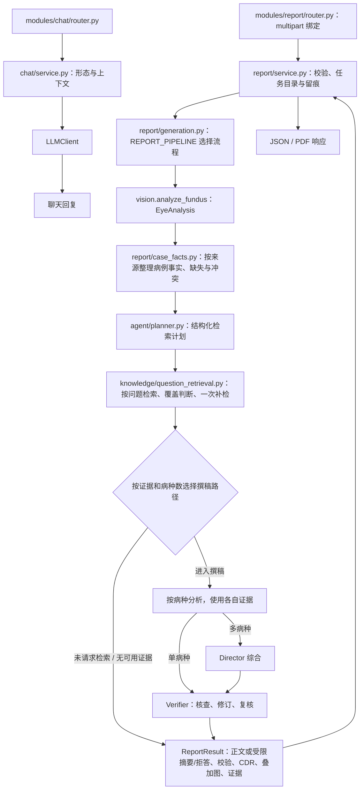

# 后端 · FastAPI

后端提供账号、会话、视觉分析和报告 API。安装 Python 3.13 与依赖的步骤见 [根目录安装指南](../README.md#安装指南)。

## 启动

从仓库根目录运行。

```powershell
.\.venv\Scripts\python.exe .\backend\main.py
```

Linux 使用 `./.venv/bin/python -m uvicorn main:app --host 127.0.0.1 --port 8000 --app-dir backend`。默认监听 `127.0.0.1:8000`。存在 `frontend/dist/index.html` 时同时托管前端，否则只提供 API。服务启动后可访问 `/docs`（Swagger UI）和 `/redoc`。

## 模块与流程

新增 [`screening/`](modules/screening/README.md) 合成病例演练模块：逐眼任务状态、补拍、模拟复核签发、版本快照、幂等收据、转诊和回执。`/api/screening/cases` 入口不调用模型、不接入真实病例，沿用账号隔离。状态、释义、JSON 及演练 PDF 均可绑定历史版本；原研究报告生成接口保持现有行为。

```text
backend/
  main.py                 应用组装、路由注册、生命周期与前端托管
  core/                   全局配置、异常、资源路径、SQLite 与 LLM 客户端
    config.py exceptions.py paths.py storage.py llm/
  common/
    deps.py               当前用户依赖与登录态
  modules/
    user/                 账号、个人 LLM 配置和用量
    conversation/         会话、消息存储、模式和图检索偏好
    chat/                 聊天生成、上下文选择、眼科问答引用校验
    report/               报告任务、分析编排、存档和 PDF
    agent/                专科、Director、Verifier 和受限工具
    knowledge/            语料读取、检索、向量存储与 graphrag/
    vision/               青光眼与 DR/AMD 研究性影像分析
    screening/            合成病例复核、版本、转诊和导入
  knowledge/corpus/       可审阅语料数据（位置保持不变）
  tests/                  离线回归
```

HTTP 路由位于各业务模块 `router.py`，应用业务位于 `service.py`，领域类型位于 `models.py`，请求/响应契约位于 `schemas.py`。详见[架构](../docs/ARCHITECTURE.md)与[数据对象](../docs/DATA_MODELS.md)。



`REPORT_PIPELINE=v2`（默认）先整理病例事实并规划检索问题，再由代码校验计划字段、按问题检索并最多补检一次；`legacy` 保留逐病种固定四主题检索，用于新旧对比与回退。两条路径共用影像分析、专科撰稿、Director 综合、Verifier 核查与交付状态语义。

普通聊天和眼科追问通过聊天服务处理。眼科问答使用 `chat/prompts.py` 的系统指令，并按配置检索和校验引用。报告角色由所选病种决定，定义在 `modules/agent/roles.py`。

## API

除注册、登录、LLM 预设外，业务接口要求 `Authorization: Bearer <token>`。未登录或令牌失效返回 401，其他用户的会话与不存在的会话统一返回 404。

| 方法 | 路径 | 说明 |
|---|---|---|
| POST | `/api/account/register` | 注册并登录，密码至少 6 位 |
| POST | `/api/account/login` | 登录 |
| POST | `/api/account/logout` | 当前令牌失效 |
| GET | `/api/account/me` | 用户与脱敏 LLM 配置 |
| GET | `/api/account/llm-presets` | 服务商预设和服务器默认端点/模型 |
| PUT / DELETE | `/api/account/llm` | 保存 / 清除用户配置 |
| POST | `/api/account/llm/test` | 真实模型连通测试，不保存配置 |
| GET | `/api/account/usage` | 会话、报告、拒答统计 |
| GET / POST | `/api/chat/conversations` | 会话列表 / 创建，默认 general |
| GET / PATCH / DELETE | `/api/chat/conversations/{id}` | 详情与完整消息 / 改名 / 删除 |
| PATCH | `/api/chat/conversations/{id}/graph` | `{"graph_enabled":true}` 或 `false`，保存当前会话的眼科问答图谱偏好 |
| PATCH | `/api/chat/conversations/{id}/mode` | `{"mode":"general"}` 或 `{"mode":"ophthalmic"}` |
| POST | `/api/chat/conversations/{id}/messages` | `{"message":"..."}`，返回回复 |
| POST | `/api/generate-report-content/` | 返回分析 JSON，并在指定会话追加临床记录与报告 |
| POST | `/api/generate-report/` | 重新分析并返回 PDF；拒答时 422 |
| GET | `/api/reports/{report_id}/pdf` | 按当前账号导出已保存的报告，页面下载使用此接口 |
| GET | `/api/get-report-image/{img_name}` | 按当前账号读取已保存报告的分割叠加图 |

两个报告接口都接受 `multipart/form-data`。`file` 为 JPG/JPEG/PNG 彩色眼底图，`note` 为可选临床记录，`conversation_id` 为可选会话 ID。通过多个同名 `diseases` 字段选择病种，可用值为 `glaucoma`、`diabetic_retinopathy` 和 `age_related_macular_degeneration`。省略该字段时分析青光眼，未知或重复值返回 422。选了 DR 或 AMD 而 FLAIR 依赖或权重无法加载时返回 503。[启用 FLAIR](modules/vision/README.md#糖网与年龄相关性黄斑变性)

PDF 只接受引用校验状态为 pass 或 rewritten 的存档。关闭校验或旧记录缺少校验状态时，正文仍可在原会话查看，PDF 接口返回 422。

正文响应字段为 `summary`、`cup_to_disc_ratio`、`img_name`、`evidence`、`verification`、`rejected`、`report_id`。影像指标通过 `visual_findings` 和 `visual_findings_text` 单独交付。FLAIR 差值由指标区展示，正文中的外部知识经引用校验。仅分析 DR 或 AMD 时 `cup_to_disc_ratio` 为空，`img_name` 为空字符串。拒答时 `summary` 展示拒答原因。

聊天与报告都要求用户保存自己的 LLM 配置，缺失返回 409，不回退使用服务器 Key。聊天模型请求失败返回 502；报告中的专科/Director 调用失败会中止任务并可能返回 500，校验故障则不交付正文。不能把 `Error:` 字符串当作有效报告。

## 检索与引用校验

`knowledge/retrieval.py` 支持 `bm25`、`vector`、`hybrid`。默认 hybrid 使用 BM25 与 `intfloat/multilingual-e5-small` 向量召回，经 RRF 融合、每源上限、语言配额与门控筛选。hybrid 的 `score` 是融合分，不能当作余弦相似度或医学置信度。

所选病种决定参与报告的专科。青光眼、DR 和 AMD 各有一份分析任务。报告基于各病种的视觉结果和共同备注分别检索，按片段 ID 去重并统一编号。专科工具只能搜索/读取当前请求已分配且最终保留的证据。

启动时后台执行 `knowledge.retrieval.selfcheck_gate()`，可能加载向量模型；失败只告警，不阻止服务启动。阈值基于语料和模型标定，替换后应重新验证。内置语料包含演示资料和带出处的图谱条款，完整指南见各条款的原文链接。

Verifier 对外部知识核查引用语义，代码另行检测未知编号，经过有限修订与复核，必要时请求最终撰稿者重生成一次。单病种由专科重写，多病种由 Director 重写，均复用影像结果和证据。状态为 `pass`、`rewritten`、`rejected`、`error` 或 `disabled`；开启校验而证据为空时为 `rejected/no_evidence`，不会因缺证据放行。关闭 LLM 校验时仍拒绝未知引用编号。病例测量真实性不在引用校验范围内，详见 [Agents](modules/agent/README.md)。

## 配置

配置来自 `core/config.py` 和 `backend/.env`，修改后重启。模板见 [.env.example](.env.example)。

| 配置 | 默认值 | 用途 |
|---|---|---|
| `HOST` / `PORT` / `RELOAD` | `127.0.0.1` / `8000` / `0` | 服务监听与开发重载 |
| `OPENAI_API_KEY` | 空 | 直接使用客户端/自检时的服务器 Key；业务接口仍要求用户配置 |
| `OPENAI_MODEL` / `OPENAI_BASE_URL` | `gpt-4.1` / 官方端点 | 默认模型与端点；服务商可用型号由用户确认 |
| `OCUPANEL_SECRET_KEY` | 首次自动生成 | Fernet 加密用户 Key，必须备份；丢失后原密文无法解密 |
| `LLM_TIMEOUT` / `LLM_MAX_RETRIES` | `120` / `1` | 单次调用超时秒数与 SDK 重试 |
| `LLM_DISABLE_THINKING` | `1` | 只对匹配 DeepSeek 的端点发送关闭 thinking 参数 |
| `REPORT_LANGUAGE` / `REPORT_FONT_PATH` | `zh` / 自动探测 | 报告语言与 PDF 中文字体 |
| `REPORT_PIPELINE` | `v2` | `v2` 按需检索；`legacy` 保留旧流程用于对比和回退 |
| `RETRIEVAL_PLAN_MAX_QUESTIONS` / `RETRIEVAL_MAX_QUERIES` | `6` / `10` | 单份报告的检索问题数与查询总数上限 |
| `RETRIEVAL_MAX_SECONDS` / `RETRIEVAL_MAX_EVIDENCE` | `20` / `12` | 检索耗时与证据条数上限 |
| `RETRIEVAL_SUPPLEMENTAL_ROUNDS` | `1` | 缺口补检轮数，0 表示不补检 |
| `CHAT_HISTORY_MAX_MESSAGES` | `20` | 历史消息条数，固定报告计入 |
| `CHAT_CONTEXT_MAX_CHARS` | `20000` | 系统指令、当前输入和选中历史的正文字符预算 |
| `CHAT_REPORT_MAX_CHARS` | `6000` | 眼科形态最近报告上限，同时受剩余预算一半限制 |
| `CHAT_MAX_OUTPUT_TOKENS` | `2048` | 聊天回复上限，不影响报告 Agents |
| `RAG_ENABLED` / `RAG_MODE` | `1` / `hybrid` | 证据检索开关与模式 |
| `RAG_TOP_K` / `RAG_MIN_SCORE` | `12` / `0.35` | 每病种证据条数与相对得分阈值；`legacy` 流程按诊断、判读、治疗、随访四方面分别检索再合并 |
| `RAG_VECTOR_MODEL` / `RAG_VECTOR_MIN_SCORE` | `intfloat/multilingual-e5-small` / `0.78` | 向量模型与绝对阈值 |
| `RAG_VECTOR_REVISION` | `main` | 模型版本，可固定为提交哈希 |
| `RAG_VECTOR_CACHE_PATH` | `knowledge/.cache/vectors.db`（相对 backend 的默认绝对路径） | 本地 SQLite 向量缓存，空字符串禁用 |
| `RAG_RRF_K` | `60` | 排名融合常数 |
| `RAG_LANG_QUOTA` / `RAG_LANG_GATE` | `1` / `0.89` | 语言配额与查询门控 |
| `RAG_MAX_PER_SOURCE` | `2` | 每源条数，0 不限 |
| `VERIFY_ENABLED` | `1` | LLM 引用语义核查；确定性检查（未知编号、编造数值、左右眼错位、病种不适用）始终执行 |
| `VERIFY_MAX_ROUNDS` / `VERIFY_MIN_CHARS` | `2` / `300` | 修订轮数与有问题短稿的重生成判据 |
| `HF_ENDPOINT` / `HF_HOME` / `HF_HUB_CACHE` | 默认 Hugging Face 源 / 用户缓存 | 下载源、Hugging Face 缓存根目录及 Hub 模型缓存目录 |
| `CORS_ORIGINS` | localhost 和 127.0.0.1 的 5500 | 跨域白名单，同源访问不依赖它 |
| `FRONTEND_DIST` | 项目 `frontend/dist` | 前端构建目录 |
| `MULTI_AGENT_MODE` | `parallel` | 唯一已实现模式；其他值在报告生成时报错 |

旧 `ANALYSIS_PIPELINE`、`VLM_MODEL`、`VLM_BACKEND` 已移除；非默认旧管线值会使启动失败。

### GraphRAG

`RAG_ENABLED` 控制报告和眼科问答是否查知识库。`GRAPH_RAG_ENABLED` 决定报告和眼科问答的默认图谱设置，用户可在当前会话的「+」菜单中切换问答图谱检索。关闭图检索时，眼科问答仍可使用 `RAG_MODE` 指定的词面或向量检索。眼科聊天保存本轮 `retrieval`、`verification` 和命中的 `evidence`，可在页面看到图谱命中、文本命中、无证据或图谱加载失败。点击正文中的引用编号可打开对应证据。开启 `VERIFY_ENABLED` 时，眼科聊天也会核查具体建议的引用，校验失败时显示补充信息提示。自动核查使用当前用户配置的 LLM，结果只反映系统已执行的引用校验。

基础条款由 [ophthalmology-graph.json](knowledge/corpus/ophthalmology-graph.json) 和独立指南 `knowledge/corpus/guidelines/*.json` 提供，两种图谱设置共用同一语料集合。新增指南填写稳定 ID、标题、章节、版本、适用范围、地区和原文链接，并建议登记条款级 `topic`、`material_type`、`review_status` 与 `applicability`，即可进入 BM25 和启用的 E5 索引。概念、别名、定向关系和锚点可选，填写后可额外参与图谱召回。现有 `POST /api/generate-report-content/` 和眼科模式的 `POST /api/chat/conversations/{id}/messages` 通过 `evidence` 返回出处字段；图检索命中还包含 `graph_path`。图谱加载失败时保留基础条款。格式和缓存生命周期见 [知识检索](knowledge/README.md)，覆盖缺口见[语料覆盖矩阵](../docs/语料覆盖矩阵.md)。

加载带出处的条款后，旧青光眼演示材料退出检索；存在 NEI AMD 条款时，旧 Markdown 摘要由该条款替代。该规则同时适用于图谱开启和关闭。图谱包含 AMD 症状评估与在英国疑似活动性湿性晚期 AMD 时适用的转诊、OCT 和血管造影条款。 [NICE NG82](https://www.nice.org.uk/guidance/ng82/chapter/recommendations#diagnosis-and-referral) · [NEI AMD 资料](https://www.nei.nih.gov/eye-health-information/eye-conditions-and-diseases/age-related-macular-degeneration)

中国 AMD 场景增加了初诊眼底检查与疑似新生血管性 AMD 的 OCT/OCTA 条款。试查「国内怀疑新生血管性 AMD，能用 OCTA 吗？」应命中中国指南。以「英国医院怀疑湿性黄斑变性，需要转诊和 OCT 吗？」做地区对照。用「英国停车收费是否有优惠？」验证 BM25 与图检索模式的无证据显示。 [中国 AMD 临床诊疗指南原文](https://www.ddzxhospital.com/library/up_f/file/20230802/202308020837477207.pdf)

完成项目依赖安装和前端构建后，可从仓库根目录启动单服务测试。以下设置只作用于当前 PowerShell 终端。BM25 与图检索无需下载向量模型，聊天生成仍需在「个人设置」配置自己的 LLM。

```powershell
$env:RAG_ENABLED = '1'
$env:GRAPH_RAG_ENABLED = '1'
$env:RAG_MODE = 'bm25'
.\.venv\Scripts\python.exe .\backend\main.py
```

打开 `http://127.0.0.1:8000`，切换到「眼科助手」，输入「英国医院怀疑湿性黄斑变性，需要转诊和 OCT 吗？」并展开证据。预期可看到 NICE NG82 的 `1.4.6` 和 `1.4.7–1.4.9`。把 `GRAPH_RAG_ENABLED` 改为 `0` 后重启，输入「年龄相关性黄斑变性 AMD，直线变弯，需要做什么检查？」可验证 NEI 摘要仍可被检索。这里检查的是资料召回，图谱条款支持对已提供病例信息的解释。

## 数据与资源生命周期

分析归档增加 `backend/original_store/` 和 reports.source_metadata，保存原图与来源哈希。备份须包含这个目录；当前没有自动原图清理器。历史缺原图不补造，按当前账号的报告归属和哈希读取。导入预览表、确认事务与缺项处理见[工作台](modules/screening/README.md)。

SQLite 固定为 `backend/ocupanel.db`，原有 users、sessions、llm_configs、conversations、messages、reports 六张表，另有 screening_cases、screening_versions、screening_requests 和 screening_import_previews 四张合成演练及导入表。密码使用 PBKDF2-HMAC-SHA256，登录令牌有效期 7 天；会话形态启动时自动迁移，已有报告的旧会话初始化为 ophthalmic，之后主动切换的状态会保留。

每次任务在 `backend/output/` 创建独占目录。正文请求结束清理；PDF 发送完毕后由后台任务清理。启动时清理超过 30 分钟的遗留任务目录，没有周期性任务清理器。`backend/img_store/` 长期保存叠加图，当前没有自动清理。备份需包含数据库、加密密钥与图片。

视觉权重按模型、类型和设备缓存，加载和推理共用进程锁；只缓存权重，不缓存分析结果。自动设备选择为 CUDA → MPS → CPU，当前本机使用 CPU 版 torch。每个 worker 都有独立模型副本，部署先使用单 worker，在目标环境实测容量。报告页使用 SQLite 持久任务队列，同一数据库同时执行一个排队报告。

会话、报告及分割图查询按用户隔离，分割图通过当前账号的报告归属核对。页面通过报告 ID 下载当前账号已保存的报告，可从历史对话访问。演练病例及其历史版本、释义和导出也按当前账号隔离；不提供机构间共享或正式医生角色授权。

## 验证与排查

```powershell
# 根目录：离线测试，不访问真实 LLM
.\.venv\Scripts\python.exe -m unittest discover -s backend/tests

# backend 下：真实服务连通自检，可能产生 API 调用费用
..\.venv\Scripts\python.exe -m core.llm.check
```

离线回归与模拟 UI 验证不使用账户真实 Key；真实视觉样本结果见 [vision](modules/vision/README.md)。未完成临床准确度、GPU、跨 Python 版本和生产并发容量验证。

500 查看后端 traceback；502 检查聊天模型连接；409 去个人设置配置 LLM；413 检查聊天字符预算或反向代理上传上限；PDF 422 查看引用校验原因。首轮分析慢应检查模型下载、缓存与网络；中文 PDF 空框则配置 `REPORT_FONT_PATH`。模型下载、服务响应和引用修订都会影响报告耗时。
