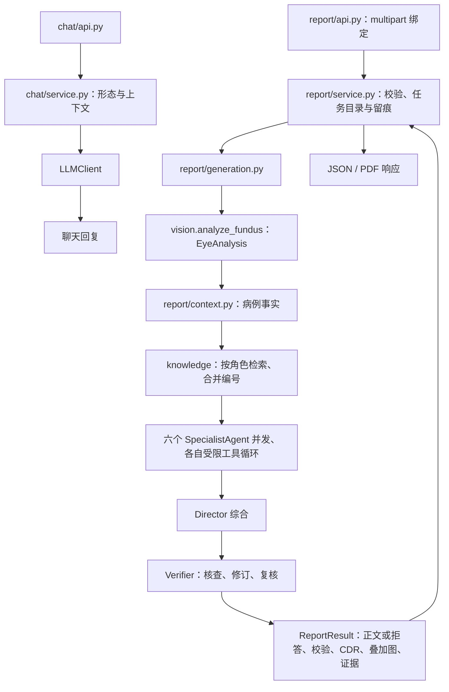

# backend — FastAPI 服务

当前开发基线为 **Python 3.13**，本机项目 `.venv` 实测 **3.13.3**。依赖固定在 [requirements.txt](requirements.txt)，安装步骤见[项目 README](../README.md)。系统默认 Python 可能与虚拟环境不同；其他 Python 版本尚未完成整体验证。

从项目根目录启动（PowerShell）：

```powershell
Set-Location backend
..\.venv\Scripts\python.exe main.py
```

Linux 使用 `../.venv/bin/python main.py`。默认监听 `127.0.0.1:8000`；存在 `frontend/dist/index.html` 时同时托管前端，否则只提供 API。接口文档为 `/docs` 和 `/redoc`。

## 模块与流程

| 模块 | 职责 |
|---|---|
| `main.py` | 应用组装、生命周期、错误映射、静态托管 |
| `user/` | 账户、用户 LLM 配置、用量 |
| `chat/` | 会话形态、消息存储、上下文选择和 LLM 问答 |
| `report/` | 上传绑定、病例组织、分析生成、留痕、PDF |
| `vision/` | 青光眼分类、视杯视盘分割、面积等效 CDR |
| `agents/` | 六专科、Director、Verifier 和受限工具 |
| `knowledge/` | 本地示例语料、BM25/向量检索、证据格式化 |
| `llm/` | 统一模型调用、超时、重试、错误描述和连通自检 |
| `utils/` | 认证、配置、路径、SQLite、应用错误 |
| `graphrag/` | 未接入当前报告链的占位骨架 |
| `tests/` | 离线回归测试 |

HTTP 路由位于各业务模块 `api.py`，应用业务位于 `service.py`，数据契约属于各模块 `models.py`。详见[架构](../docs/ARCHITECTURE.md)与[数据对象](../docs/DATA_MODELS.md)。



普通聊天和眼科追问不执行报告流程。形态切换只保存状态；眼科问答每次请求注入 `chat/prompts.py`。报告默认六角色为眼科医生、验光师、青光眼专科、全科医生、眼科技师、药师；角色定义在 `agents/roles.py`。

## API

除注册、登录、LLM 预设外，业务接口要求 `Authorization: Bearer <token>`。未登录或令牌失效返回 401，其他用户的会话与不存在的会话统一返回 404。

| 方法 | 路径 | 说明 |
|---|---|---|
| POST | `/api/account/register` | 注册并登录，密码至少 6 位 |
| POST | `/api/account/login` | 登录 |
| POST | `/api/account/logout` | 当前令牌失效 |
| GET | `/api/account/me` | 用户与脱敏 LLM 配置 |
| GET | `/api/account/llm-presets` | 服务商预设和服务器默认端点/模型 |
| PUT / DELETE | `/api/account/llm` | 保存 / 清除用户配置 |
| POST | `/api/account/llm/test` | 真实模型连通测试，不保存配置 |
| GET | `/api/account/usage` | 会话、报告、拒答统计 |
| GET / POST | `/api/chat/conversations` | 会话列表 / 创建，默认 general |
| GET / PATCH / DELETE | `/api/chat/conversations/{id}` | 详情与完整消息 / 改名 / 删除 |
| PATCH | `/api/chat/conversations/{id}/mode` | `{"mode":"general"}` 或 `{"mode":"ophthalmic"}` |
| POST | `/api/chat/conversations/{id}/messages` | `{"message":"..."}`，返回回复 |
| POST | `/api/generate-report-content/` | 返回分析 JSON，并在指定会话追加临床记录与报告 |
| POST | `/api/generate-report/` | 重新分析并返回 PDF；拒答时 422 |
| GET | `/api/get-report-image/{img_name}` | 获取保存的分割叠加图 |

报告表单使用 `multipart/form-data`：`file` 为 JPG/JPEG/PNG 文件，`note` 为可选临床记录，`conversation_id` 为可选会话 ID。`parse_report_submission()` 转为 `ReportSubmission`，当前用户由令牌注入，不能由表单指定。无会话 ID 时接口不自动创建会话；前端会预先创建。

正文响应字段为 `summary`、`cup_to_disc_ratio`、`img_name`、`evidence`、`verification`、`rejected`、`report_id`。拒答时 `summary` 为原因展示文本，不是未通过的报告草稿。CDR 可能为空，且仍是当前青光眼展示字段，不表示所有病种都使用 CDR。

聊天与报告都要求用户保存自己的 LLM 配置，缺失返回 409，不回退使用服务器 Key。聊天模型请求失败返回 502；报告中的专科/Director 调用失败会中止任务并可能返回 500，校验故障则不交付正文。不能把 `Error:` 字符串当作有效报告。

## 检索与引用校验

`knowledge/retrieval.py` 支持 `bm25`、`vector`、`hybrid`。默认 hybrid 使用 BM25 与 `intfloat/multilingual-e5-small` 向量召回，经 RRF 融合、每源上限、语言配额与门控筛选。hybrid 的 `score` 是融合分，不能当作余弦相似度或医学置信度。

六角色分别检索，报告侧合并、去重并统一引用编号，最多保留 `max(RAG_TOP_K * 2, 6)` 条。专科工具只能搜索/读取当前请求已分配且最终保留的证据；当前没有网络医学搜索或任意文件/命令工具。

启动时后台执行 `knowledge.retrieval.selfcheck_gate()`，可能加载向量模型；失败只告警，不阻止服务启动。阈值是语料和模型相关的标定值，替换后应重新验证，旧版本记录的相似度和延迟不是性能保证。四份 corpus 文件均为演示语料，不能称为已接入权威指南全文。

Verifier 对外部知识核查引用语义，代码另行检测未知编号，经过有限修订与复核，必要时要求 Director 重生成一次；不重跑影像与六专科。状态为 `pass`、`rewritten`、`rejected`、`error` 或 `disabled`；开启校验而证据为空时为 `rejected/no_evidence`，不会因缺证据放行。关闭 LLM 校验时仍拒绝未知引用编号。病例测量真实性不在引用校验范围内，详见 [Agents](agents/README.md)。

## 配置

配置来自 `utils/config.py` 和 `backend/.env`，修改后重启。模板见 [.env.example](.env.example)。

| 配置 | 默认值 | 用途 |
|---|---|---|
| `HOST` / `PORT` / `RELOAD` | `127.0.0.1` / `8000` / `0` | 服务监听与开发重载 |
| `OPENAI_API_KEY` | 空 | 直接使用客户端/自检时的服务器 Key；业务接口仍要求用户配置 |
| `OPENAI_MODEL` / `OPENAI_BASE_URL` | `gpt-4.1` / 官方端点 | 默认模型与端点；服务商可用型号由用户确认 |
| `OCUPANEL_SECRET_KEY` | 首次自动生成 | Fernet 加密用户 Key，必须备份；丢失后原密文无法解密 |
| `LLM_TIMEOUT` / `LLM_MAX_RETRIES` | `120` / `1` | 单次调用超时秒数与 SDK 重试 |
| `LLM_DISABLE_THINKING` | `1` | 只对匹配 DeepSeek 的端点发送关闭 thinking 参数 |
| `REPORT_LANGUAGE` / `REPORT_FONT_PATH` | `zh` / 自动探测 | 报告语言与 PDF 中文字体 |
| `CHAT_HISTORY_MAX_MESSAGES` | `20` | 历史消息条数，固定报告计入 |
| `CHAT_CONTEXT_MAX_CHARS` | `20000` | 系统指令、当前输入和选中历史的正文字符预算 |
| `CHAT_REPORT_MAX_CHARS` | `6000` | 眼科形态最近报告上限，同时受剩余预算一半限制 |
| `CHAT_MAX_OUTPUT_TOKENS` | `2048` | 聊天回复上限，不影响报告 Agents |
| `RAG_ENABLED` / `RAG_MODE` | `1` / `hybrid` | 证据检索开关与模式 |
| `RAG_TOP_K` / `RAG_MIN_SCORE` | `4` / `0.35` | 角色召回数量与相对得分阈值 |
| `RAG_VECTOR_MODEL` / `RAG_VECTOR_MIN_SCORE` | `intfloat/multilingual-e5-small` / `0.78` | 向量模型与绝对阈值 |
| `RAG_RRF_K` | `60` | 排名融合常数 |
| `RAG_LANG_QUOTA` / `RAG_LANG_GATE` | `1` / `0.89` | 语言配额与查询门控 |
| `RAG_MAX_PER_SOURCE` | `2` | 每源条数，0 不限 |
| `VERIFY_ENABLED` | `1` | LLM 引用语义核查 |
| `VERIFY_MAX_ROUNDS` / `VERIFY_MIN_CHARS` | `2` / `300` | 修订轮数与有问题短稿的重生成判据 |
| `HF_ENDPOINT` / `HF_HOME` | 默认 Hugging Face 源 / 用户缓存 | 镜像与缓存根目录；HF_HOME 由下载库读取 |
| `CORS_ORIGINS` | localhost 和 127.0.0.1 的 5500 | 跨域白名单，同源访问不依赖它 |
| `FRONTEND_DIST` | 项目 `frontend/dist` | 前端构建目录 |
| `MULTI_AGENT_MODE` | `parallel` | 唯一已实现模式；其他值在报告生成时报错 |

`GRAPH_RAG_ENABLED`、`GRAPH_STORE`、`AGENT_TRACE_ENABLED` 只有占位配置，当前报告链未接入图检索或 Agent 轨迹持久化。`EXPIRY_SECONDS`、`CLEANUP_INTERVAL` 是遗留未使用配置，不控制当前任务清理。旧 `ANALYSIS_PIPELINE`、`VLM_MODEL`、`VLM_BACKEND` 已移除；非默认旧管线值会使启动失败。

## 数据与资源生命周期

SQLite 固定为 `backend/ocupanel.db`，有 users、sessions、llm_configs、conversations、messages、reports 六张表。密码使用 PBKDF2-HMAC-SHA256，登录令牌有效期 7 天；会话形态启动时自动迁移，已有报告的旧会话初始化为 ophthalmic，之后主动切换的状态会保留。

每次任务在 `backend/output/` 创建独占目录。正文请求结束清理；PDF 发送完毕后由后台任务清理。启动时清理超过 30 分钟的遗留任务目录，没有周期性任务清理器。`backend/img_store/` 长期保存叠加图，当前没有自动清理。备份需包含数据库、加密密钥与图片。

视觉权重按模型、类型和设备缓存，加载和推理共用进程锁；只缓存权重，不缓存分析结果。自动设备选择为 CUDA → MPS → CPU，当前本机使用 CPU 版 torch。每个 worker 都有独立模型副本，部署先使用单 worker，在目标环境实测容量。当前没有完整报告任务队列。

会话查询按用户隔离，但分割图接口只要求登录和安全文件名，尚未核对图像所属用户。PDF 接口重新生成，尚不能直接导出已存报告；刷新后前端不再持有原上传文件，也就没有对应下载入口。

## 验证与排查

```powershell
# 根目录：离线测试，不访问真实 LLM
.\.venv\Scripts\python.exe -m unittest discover -s backend/tests

# backend 下：真实服务连通自检，可能产生 API 调用费用
..\.venv\Scripts\python.exe -m llm.check
```

离线回归与模拟 UI 验证不使用账户真实 Key；真实视觉样本结果见 [vision](vision/README.md)。未完成临床准确度、GPU、跨 Python 版本和生产并发容量验证。

500 查看后端 traceback；502 检查聊天模型连接；409 去个人设置配置 LLM；413 检查聊天字符预算或反向代理上传上限；PDF 422 查看引用校验原因。首轮分析慢应检查模型下载、缓存与网络；中文 PDF 空框则配置 `REPORT_FONT_PATH`。不要用固定秒数承诺报告耗时。
