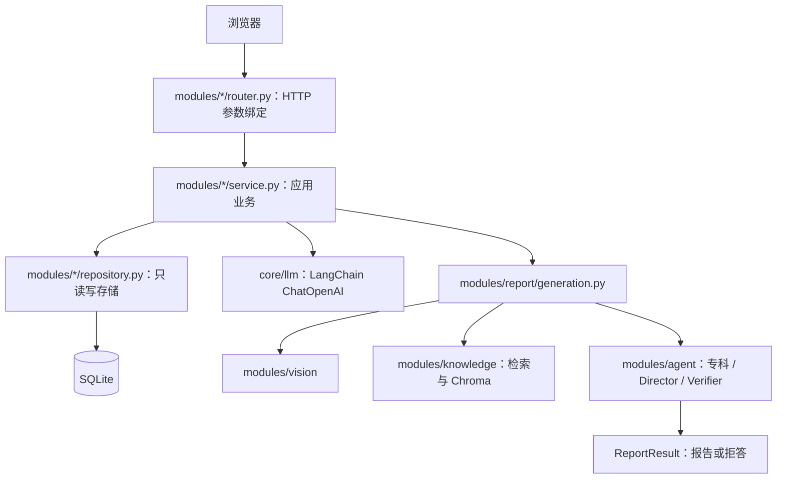

# 当前项目结构

以仓库当前实现为准。历史 ADR 和升级规格描述的是当时方案，不代表尚未实现的功能已经可用。

```text
backend/
  app/main.py             应用组装：中间件、路由注册、生命周期、前端托管
  core/                   全局能力
    config.py             配置出口（实现见 config_impl.py）
    paths.py              项目路径
    errors.py             可预期的业务错误
    storage.py            SQLite 持久化（用户、会话、报告留痕）
    llm/                  模型连接、请求、超时与错误处理（LangChain ChatOpenAI）
  common/                 公共依赖
    auth.py               登录态与 CurrentUser 依赖
  modules/                按业务功能分包，每个模块自带 router/service/repository/models/schemas
    account/              注册登录、个人 LLM 配置、用量概览
      router.py service.py repository.py models.py schemas.py llm_probe.py
    chat/                 会话形态、消息与问答
      router.py service.py repository.py models.py schemas.py context.py prompts.py
    report/               报告生成与 PDF
      router.py service.py repository.py models.py generation.py drafting.py
      context.py pdf.py queue.py assets.py settings.py source_summary.py utils/
    agent/                专科分析、Director、Verifier 及工具
      specialist.py director.py verifier.py parallel.py roles.py models.py
      prompts/ tools/
    knowledge/            检索、语料装载与图检索
      retrieval.py service.py chroma_store.py corpus.py models.py report_focus.py
      graphrag/           证据图谱装载、术语匹配和多跳检索
  knowledge/corpus/       语料数据（Markdown、PDF 与指南 JSON），保留在原位便于审阅
  tests/                  离线数值、Agent、路由和业务测试
frontend/                 React 界面与 HTTP 客户端
```

代码分层约定：`router` 只做 HTTP 绑定，`service` 承担业务，`repository` 只读写存储，
`models` 放领域类型，`schemas` 放请求/响应结构。跨模块调用走对方的 `service`，
不直接引 `repository`，避免绕过业务规则。

检索栈：LangChain 负责语料切分（Markdown 标题 + 段落/句子）与模型调用（ChatOpenAI）；
向量由 `intfloat/multilingual-e5-small` 编码，存入 Chroma（`chroma_store.py`），
库中每条记录同时保存向量、原文与出处元数据，语料变化时按 id 增量同步。
chromadb 的 `PersistentClient` 在 Windows 上无法打开持久化路径，因此采用
「Chroma 内存索引 + 本地快照（passages.json / vectors.npy）」的组合，重启复用快照。

## 请求如何进入业务

入口是 `app/main.py`：它只做组装（中间件、路由注册、生命周期、前端托管），不含业务逻辑。
每个业务模块（`modules/<name>/`）内部按 `router → service → repository` 分层：



跨模块调用只经过对方的 `service`，不直接引用其 `repository`，避免绕过业务规则。

合成阅片协作由 `modules/screening/` 负责：`models.py` 定义逐眼任务及操作契约，`api.py` 绑定接口，`service.py` 执行复核签发和转诊状态变更，`repository.py` 在同一事务中保存当前状态、不可变版本和幂等收据。`presentation.py` 提供版本绑定的释义和演练 PDF 正文，`evaluation.py` 计算新旧方法预先锁定决定的配对结果。此入口不调用原视觉报告管线。[模块约束](../backend/modules/screening/README.md)

## 上传参数的含义

开发环境以 Python 3.13 为基线，本机 `.venv` 为 3.13.3；系统默认 Python 与项目解释器可能不同，详见[环境与启动](../README.md#前置要求)。报告页经持久任务 API 提交，按任务号轮询结果。后端按数据库串行消费，病例状态变更使用独立的版本化事务。

`user: auth.CurrentUser` 由 Authorization 请求头中的 Bearer 令牌解析，客户端不能通过表单指定当前用户。`file` 是 multipart 的文件字段；`note` 和 `conversation_id` 是同一表单中的字符串字段。`parse_report_submission()` 将图片、备注、会话 ID 及所选病种组装成 ReportSubmission，通过 Depends 注入路由。路由仅接收 user 和 request 两个对象，再委托 report/service.py。

普通 JSON 请求使用 user/models.py、chat/models.py 中的 Pydantic 请求类。不能把上传文件直接改成普通 JSON 对象，否则会破坏现有 multipart 协议。

## 开发约定

- 每个业务模块的 router.py 只声明路由、HTTP 输入绑定和响应构造，不写模型推理、数据库操作和报告生成。
- service.py 接收已命名的数据对象，负责业务和资源生命周期；通过 ApplicationError 表达可预期错误，app/main.py 统一映射为 HTTP。
- repository.py 只做存储读写：本模块的 SQL 或底层调用集中在这里，service 不直接拼 SQL。
- models.py 放领域类型，schemas.py 放请求/响应结构。跨模块使用时直接导入拥有方，不复制定义。配置实例放在所属模块，例如 modules/agent/roles.py、modules/report/settings.py。
- 实现类留在业务模块；models.py 只保存数据契约，不保存执行逻辑。
- 公共接口标注参数与返回类型。异构 JSON 用 dict[str, Any]，已有明确结构时使用命名模型。
- 文件名体现实际职责：generation、context、retrieval、pdf、roles；不使用缺少含义的 workflow 或万能业务工具模块。
- core 只收全局能力（配置、路径、错误、持久化、模型连接），common 只收跨模块的公共依赖（认证）；领域工具放在领域内部的 tools/ 或 utils/。
- 前端 URL、multipart 字段和 JSON 字段保持兼容；重构后用路由和业务回归测试验证。

## 当前能力与限制

眼科分析入口可选择青光眼、糖尿病视网膜病变（DR）及年龄相关性黄斑变性（AMD）。青光眼采用专用分类与视盘视杯分割，DR 和 AMD 共用一次 FLAIR 眼底图像编码，逐病种比较提示词。所选病种决定参与报告的专科。按病种检索并统一编号。单病种由专科成稿，多病种由 Director 综合。Verifier 核查正文引用，页面和 PDF 单独展示结构化影像结果。CDR 和分割叠加图用于青光眼。[视觉模块与启用方式](../backend/modules/vision/README.md)

## 工具响应与校验失败处理

专科 Agent 支持普通报告文本、完整 JSON 对象及包裹在 JSON Markdown 代码块中的操作。损坏的结构化操作不能作为报告返回。最终草稿生成后，Verifier 将代码检测到的未知引用编号和模型识别的语义问题合并，执行修订、复核或拒答。未知编号不会因为模型漏检而通过；关闭 LLM 校验时也不允许未知编号进入输出。

旧 ANALYSIS_PIPELINE/VLM_MODEL/VLM_BACKEND 已不再作为可用配置。迁移时删除这些旧设置；若仍指定非默认 ANALYSIS_PIPELINE 值，启动会明确拒绝，以避免静默使用不同模型。历史 ADR、规格与研究文档已标记为历史记录，不是当前能力清单。

## 两种会话形态

初次进入与新建会话默认为普通聊天，可在欢迎页或聊天页切换为眼科助手。模式按会话保存，重新打开会话会恢复。普通聊天不注入眼科系统提示词；眼科助手使用 chat/prompts.py 的业务指令。

普通聊天和眼科助手均可通过提问栏左侧「+」打开「眼科影像分析」，欢迎页保留直接入口。上传图片与医疗报告/临床记录并提交后，进入当前聊天，自动切为眼科助手，显示生成状态和报告回复，随后可继续追问。未提交分析时只切换形态，不执行视觉模型、Agents 或产生报告费用。切回普通聊天保留已有消息。

后端的 PATCH /api/chat/conversations/{id}/mode 负责持久化形态；旧数据库在启动时迁移，旧报告会话保留眼科助手语义。详细规则见 backend/chat/README.md。llm/ 不再包含眼科提示词，分析 Agent 与聊天各自管理指令。

## 上下文窗口

chat/context.py 在聊天业务层选择发送给模型的消息窗口，保留数据库完整记录。输入同时受历史条数与正文字符预算限制；眼科形态固定最近报告并标记长报告节选。输出预算由 CHAT_MAX_OUTPUT_TOKENS 控制，仅作用于 chat_with_history。限制及遗忘行为详见 backend/modules/chat/README.md，字符数不冒充精确 token 数。
