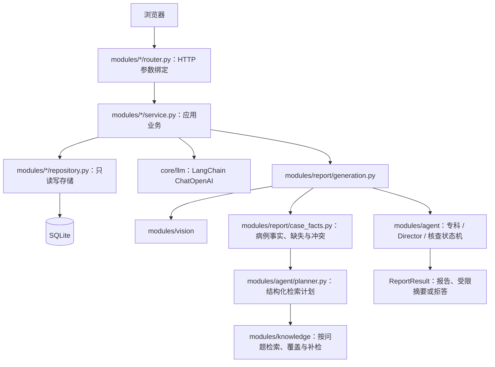

# 当前项目结构

以仓库当前实现为准。历史 ADR 和升级规格描述的是当时方案，不代表尚未实现的功能已经可用。

```text
backend/
  main.py                 应用组装、路由注册、生命周期与前端托管
  core/                   全局配置、异常、资源路径、SQLite 与 LLM 客户端
    config.py exceptions.py paths.py storage.py llm/
  common/
    deps.py               当前用户依赖与登录态
  modules/
    user/                 账号、个人 LLM 配置和用量
    conversation/         会话、消息存储、模式和图检索偏好
    chat/                 聊天生成、上下文选择、眼科问答引用校验
    report/               报告任务、分析编排、存档和 PDF
    agent/                专科、Director、Verifier 和受限工具
    knowledge/            语料读取、检索、向量存储与 graphrag/
    vision/               青光眼与 DR/AMD 研究性影像分析
    screening/            合成病例复核、版本、转诊和导入
  knowledge/corpus/       可审阅语料数据（位置保持不变）
  tests/                  离线回归
```

代码分层约定：`router` 只做 HTTP 绑定，`service` 承担业务，`repository` 只读写存储，
`models` 放领域类型，`schemas` 放请求/响应结构。跨模块调用走对方的 `service`，
不直接引 `repository`，避免绕过业务规则。

检索栈：LangChain 负责语料切分（Markdown 标题 + 段落/句子）与模型调用（ChatOpenAI），
引用核查的控制流是 LangGraph 状态机（`backend/modules/agent/graphs/verify.py`）；
向量由 `intfloat/multilingual-e5-small` 编码，存入 Chroma（`chroma_store.py`），
库中每条记录同时保存向量、原文与出处元数据，语料变化时按 id 增量同步。
chromadb 的 `PersistentClient` 在 Windows 上无法打开持久化路径，因此采用
「Chroma 内存索引 + 本地快照（passages.json / vectors.npy）」的组合，重启复用快照。

## 请求如何进入业务

入口是 `main.py`：它只做组装（中间件、路由注册、生命周期、前端托管），不含业务逻辑。
有 HTTP 接口的业务模块按 `router → service → repository` 分层；领域类型放在 models.py，请求契约放在 schemas.py。按实际职责建立文件，纯分析模块无需空路由或存储层。聊天生成通过 conversation/service.py 访问会话和消息，通过 user/service.py 读取模型配置。现有通用 SQLite 实现仍在 core/storage.py，由业务仓储封装。



跨模块调用只经过对方的 `service`，不直接引用其 `repository`，避免绕过业务规则。

合成阅片协作由 `modules/screening/` 负责：`models.py` 定义逐眼任务，`schemas.py` 定义创建和操作请求，`router.py` 绑定接口，`service.py` 执行复核签发和转诊状态变更，`repository.py` 在同一事务中保存当前状态、不可变版本和幂等收据。`presentation.py` 提供版本绑定的释义和演练 PDF 正文，`evaluation.py` 计算新旧方法预先锁定决定的配对结果。此入口不调用原视觉报告管线。[模块约束](../backend/modules/screening/README.md)

## 上传参数的含义

开发环境以 Python 3.13 为基线，本机 `.venv` 为 3.13.3；系统默认 Python 与项目解释器可能不同，详见[环境与启动](../README.md#安装指南)。报告页经持久任务 API 提交，按任务号轮询结果。后端按数据库串行消费，病例状态变更使用独立的版本化事务。

`user: auth.CurrentUser` 由 Authorization 请求头中的 Bearer 令牌解析，客户端不能通过表单指定当前用户。`file` 是 multipart 的文件字段；`note` 和 `conversation_id` 是同一表单中的字符串字段。`parse_report_submission()` 将图片、备注、会话 ID 及所选病种组装成 ReportSubmission，通过 Depends 注入路由。路由仅接收 user 和 request 两个对象，再委托 report/service.py。

普通 JSON 请求使用 modules/user/schemas.py、modules/conversation/schemas.py 中的 Pydantic 请求类。不能把上传文件直接改成普通 JSON 对象，否则会破坏现有 multipart 协议。

## 开发约定

- 每个业务模块的 router.py 只声明路由、HTTP 输入绑定和响应构造，不写模型推理、数据库操作和报告生成。
- service.py 接收已命名的数据对象，负责业务和资源生命周期；通过 ApplicationError 表达可预期错误，main.py 统一映射为 HTTP。
- repository.py 只做存储读写：本模块的 SQL 或底层调用集中在这里，service 不直接拼 SQL。
- models.py 放领域类型，schemas.py 放请求/响应结构。跨模块使用时直接导入拥有方，不复制定义。配置实例放在所属模块，例如 modules/agent/roles.py、modules/report/settings.py。
- 实现类留在业务模块；models.py 只保存数据契约，不保存执行逻辑。
- 公共接口标注参数与返回类型。异构 JSON 用 dict[str, Any]，已有明确结构时使用命名模型。
- 文件名体现实际职责：generation、context、retrieval、pdf、roles；不使用缺少含义的 workflow 或万能业务工具模块。
- core 只收全局能力（配置、路径、错误、持久化、模型连接），common 只收跨模块的公共依赖（认证）；领域工具放在领域内部的 tools/ 或 utils/。
- 前端 URL、multipart 字段和 JSON 字段保持兼容；重构后用路由和业务回归测试验证。

## 当前能力与限制

眼科分析入口可选择青光眼、糖尿病视网膜病变（DR）及年龄相关性黄斑变性（AMD）。青光眼采用专用分类与视盘视杯分割，DR 和 AMD 共用一次 FLAIR 眼底图像编码，逐病种比较提示词。所选病种决定参与报告的专科。单病种由专科成稿，多病种由 Director 综合。Verifier 核查正文引用，页面和 PDF 单独展示结构化影像结果。CDR 和分割叠加图用于青光眼。[视觉模块与启用方式](../backend/modules/vision/README.md)

报告流程由 `REPORT_PIPELINE` 选择。默认 `v2` 先按来源整理病例事实（`report/case_facts.py`，稳定 ID、眼别、原始位置、缺失与冲突），再由 `agent/planner.py` 产出结构化检索计划（是否需要检索、问题主题、触发事实、病种/人群/阶段/来源类型筛选、缺失信息），代码校验后交给 `knowledge/question_retrieval.py` 按问题检索、检查覆盖并最多补检一次，最后用统一提示词撰稿并核查。`legacy` 保留旧的逐病种固定四主题检索，用于对比与回退。两条路径共用影像分析、专科、Director、Verifier 与交付状态。检索预算由 `RETRIEVAL_*` 控制，所有查询、缺口与故障写入 `verification.retrieval`。

语料条款可携带材料类型、审核状态、主题与适用条件（`knowledge/metadata.py`）。诊疗主题只接受指南/共识/综述类条款，患者教育材料只支撑解释，缺失的审核状态或适用条件保持 unknown，不自动当作已审核或已满足。三病种覆盖与缺口由 `backend/tools/corpus_coverage.py` 生成[语料覆盖矩阵](语料覆盖矩阵.md)，评估病例集见 [`backend/tests/fixtures/report_eval_cases.json`](../backend/tests/fixtures/report_eval_cases.json)，基线与评估口径见[报告流程基线](报告流程基线.md)。

## 工具响应与校验失败处理

专科 Agent 支持普通报告文本、完整 JSON 对象及包裹在 JSON Markdown 代码块中的操作。损坏的结构化操作不能作为报告返回。最终草稿生成后，Verifier 将代码检测到的未知引用编号和模型识别的语义问题合并，执行修订、复核或拒答。未知编号不会因为模型漏检而通过；关闭 LLM 校验时也不允许未知编号进入输出。

v2 流程另在模型核查之外执行确定性检查：正文中的计量数值必须能回溯到病例输入或检索资料、左右眼数值不得错位、引用条款的病种必须与本次分析一致；命中按核心问题处理。检索计划、覆盖缺口、失败记录、材料类型与审核状态写入 `verification.retrieval`、`knowledge_gaps` 与 `applicability`，与引用核查结果分开保存。

旧 ANALYSIS_PIPELINE/VLM_MODEL/VLM_BACKEND 已不再作为可用配置。迁移时删除这些旧设置；若仍指定非默认 ANALYSIS_PIPELINE 值，启动会明确拒绝，以避免静默使用不同模型。历史 ADR、规格与研究文档已标记为历史记录，不是当前能力清单。

## 校验链路的容错与降级

校验链路本身不应成为失败源。此前 grounding 漏列某个引用会让整次核查报 `invalid_claims`，
用户看到的是「校验故障」而不是「这句没核实」。现在改为逐句返回缺出处的分句，
作为普通问题进入修订轮次；模型改写引文导致定位失败时，先对齐到最接近的正文原句
（`snap_to_sentence`），对不上才按格式错误重试。

问题按成因分两类处置：

**必须改对（修订轮数用尽仍存在则拒答）**
- 引用不存在的编号（`citation_control`）；
- 资料中的数值与正文冲突，如资料写 5–6 个月、正文写 2 个月；
- 整句无依据的具体处置（剂量、时限、复查频率、手术用药）；
- 标为病例复述却凭空给出检查数值——编造患者数据；
- `partial` 且既不能归因为引用不当，也不属于收窄结论的表述。

**可标注交付**（`VERIFY_SOFT_DELIVERY`，默认开启）
- 资料恰好没写到的断言（`uncited`/`unsupported`）；
- 引文被模型改写导致查无实据（`source_audit`）、grounding 未给出处
  （`grounding_gap`）——去掉该编号后就地标注；
- 保守表述、指南适用性说明、带有效引用的 `partial` 条款。

标注为句末〔未获资料支持〕，并逐条记入 `verification.annotations`，页面单独列出。

判据刻意不看 `impact` 字段：提示词写着「无法判断影响时也用 core」、
「不要把个体诊断或治疗建议标成 local」，模型因此几乎总标 core。
以它作判据时降级交付形同虚设（实测交付率不足 1/4）。

实测（青光眼单病种，`deepseek-flash`，关闭推理）：交付率 5/6，
单份报告 38–74 秒，平均 58 秒。

报告任务在 `report_jobs.progress` 中记录当前阶段（影像分析 / 撰稿与核查），
供前端显示进度。刻意不推送正文片段：流式输出正文后若最终核查判定不可交付，
用户已读到的内容被撤回反而更难处理。

推理关闭（`LLM_DISABLE_THINKING`，默认开启）是耗时的主要来源：实测同一道核查题
开启思考 1.6 秒 / 128 输出 token（其中 96 个是 reasoning），关闭后 0.7 秒 / 34 token，
判断结论一致且更少误判保守表述。报告生成要做 8–10 次调用，累计即数分钟差距。

## 两种会话形态

初次进入与新建会话默认为普通聊天，可在欢迎页或聊天页切换为眼科助手。模式按会话保存，重新打开会话会恢复。普通聊天不注入眼科系统提示词；眼科助手使用 chat/prompts.py 的业务指令。

普通聊天和眼科助手均可通过提问栏左侧「+」打开「眼科影像分析」，欢迎页保留直接入口。上传图片与医疗报告/临床记录并提交后，进入当前聊天，自动切为眼科助手，显示生成状态和报告回复，随后可继续追问。未提交分析时只切换形态，不执行视觉模型、Agents 或产生报告费用。切回普通聊天保留已有消息。

后端的 PATCH /api/chat/conversations/{id}/mode 负责持久化形态；旧数据库在启动时迁移，旧报告会话保留眼科助手语义。详细规则见 backend/modules/chat/README.md。llm/ 不再包含眼科提示词，分析 Agent 与聊天各自管理指令。

## 上下文窗口

chat/context.py 在聊天业务层选择发送给模型的消息窗口，保留数据库完整记录。输入同时受历史条数与正文字符预算限制；眼科形态固定最近报告并标记长报告节选。输出预算由 CHAT_MAX_OUTPUT_TOKENS 控制，仅作用于 chat_with_history。限制及遗忘行为详见 backend/modules/chat/README.md，字符数不冒充精确 token 数。
