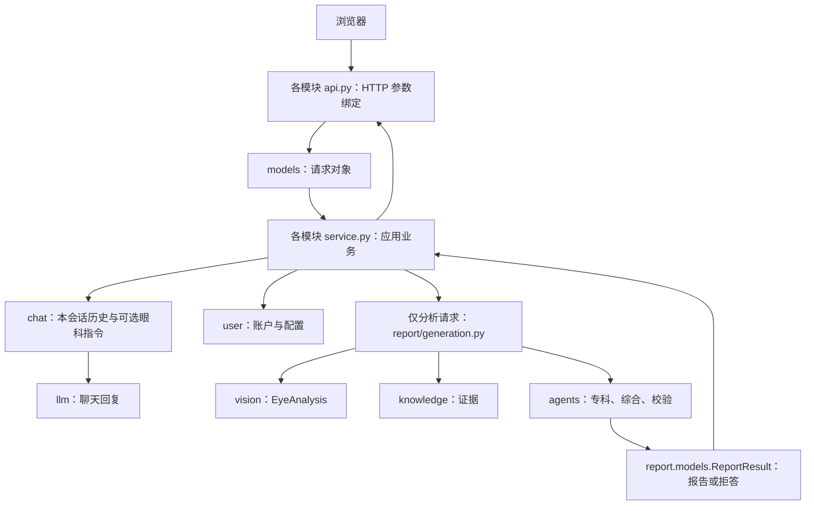

# 当前项目结构

以仓库当前实现为准。历史 ADR 和升级规格描述的是当时方案，不代表尚未实现的功能已经可用。

```text
backend/
  main.py                 FastAPI 组装、启动及静态页面托管
  各模块/models.py        该领域拥有的数据对象与接口类型
  user/api.py             用户 HTTP 路由
  user/service.py         账户、LLM 配置和用量业务
  chat/api.py             会话 HTTP 路由
  chat/service.py         会话形态、消息和问答业务
  chat/prompts.py         眼科助手会话指令，仅眼科形态注入
  report/api.py           上传参数绑定、报告/图片 HTTP 响应
  report/service.py       生成任务、记录保存和文件交付
  report/generation.py    影像分析、专科、综合与校验的生成流程
  report/context.py       组织病例事实
  report/pdf.py           PDF 渲染
  report/settings.py      有类型的展示标签与字体配置
  agents/                 专科分析、Director、Verifier 及工具
  agents/roles.py         唯一的专科角色与检索关键词定义
  vision/                 影像模型、测量和可视化
  knowledge/              检索与知识语料
  graphrag/               未接入报告链的图检索占位骨架
  llm/                    模型连接、请求、超时与错误处理
  utils/                  认证、配置、路径、持久化和应用错误
  tests/                  离线数值、Agent、路由和业务测试
frontend/                 React 界面与 HTTP 客户端
```

## 请求如何进入业务



## 上传参数的含义

开发环境以 Python 3.13 为基线，本机 `.venv` 为 3.13.3；系统默认 Python 与项目解释器可能不同，详见[环境与启动](../README.md#前置要求)。当前没有消息流式返回或异步任务队列 API。

`user: auth.CurrentUser` 由 Authorization 请求头中的 Bearer 令牌解析，客户端不能通过表单指定当前用户。`file` 是 multipart 的文件字段；`note` 和 `conversation_id` 是同一表单中的字符串字段。`parse_report_submission()` 将后三者组装成 ReportSubmission，通过 Depends 注入路由。路由仅接收 user 和 request 两个对象，再委托 report/service.py。

普通 JSON 请求使用 user/models.py、chat/models.py 中的 Pydantic 请求类。不能把上传文件直接改成普通 JSON 对象，否则会破坏现有 multipart 协议。

## 开发约定

- 每个领域的 api.py 只声明路由、HTTP 输入绑定和响应构造，不写模型推理、数据库操作和报告生成。
- service.py 接收已命名的数据对象，负责业务和资源生命周期；通过 ApplicationError 表达可预期错误，main.py 统一映射为 HTTP。
- 数据模型放在所属模块的 models.py。跨模块使用时直接导入拥有方，不复制定义。配置实例放在所属模块，例如 agents/roles.py、report/settings.py。
- 实现类留在业务模块；models.py 只保存数据契约，不保存执行逻辑。
- 公共接口标注参数与返回类型。异构 JSON 用 dict[str, Any]，已有明确结构时使用命名模型。
- 文件名体现实际职责：generation、context、retrieval、pdf、roles；不使用缺少含义的 workflow 或万能业务工具模块。
- utils 只收基础设施，领域工具放在领域内部的 tools/ 或 utils/。
- 前端 URL、multipart 字段和 JSON 字段保持兼容；重构后用路由和业务回归测试验证。

## 当前能力与限制

影像目前只实现青光眼模型，结果结构支持按病种扩展。专科 Agent 有受限的证据搜索/读取循环，Director 综合，Verifier 修订与复核。报告/PDF 的 CDR 和单张叠加图仍是当前展示约定，不表示其他病种已完成接入。前端增加会话形态切换和独立眼科分析入口。

## 工具响应与校验失败处理

专科 Agent 支持普通报告文本、完整 JSON 对象及包裹在 JSON Markdown 代码块中的操作。损坏的结构化操作不能作为报告返回。Director 输出草稿后，Verifier 将代码检测到的未知引用编号和模型识别的语义问题合并，执行修订、复核或拒答。未知编号不会因为模型漏检而通过；关闭 LLM 校验时也不允许未知编号进入输出。

旧 ANALYSIS_PIPELINE/VLM_MODEL/VLM_BACKEND 已不再作为可用配置。迁移时删除这些旧设置；若仍指定非默认 ANALYSIS_PIPELINE 值，启动会明确拒绝，以避免静默使用不同模型。历史 ADR、规格与研究文档已标记为历史记录，不是当前能力清单。

## 两种会话形态

初次进入与新建会话默认为普通聊天，可在欢迎页或聊天页切换为眼科助手。模式按会话保存，重新打开会话会恢复。普通聊天不注入眼科系统提示词；眼科助手使用 chat/prompts.py 的业务指令。

侧栏“眼科分析”是独立入口，眼科助手聊天页也提供“影像与报告分析”。上传图片与医疗报告/临床记录并提交后，进入当前聊天，自动切为眼科助手，显示生成状态和报告回复，随后可继续追问。未提交分析时只切换形态，不执行视觉模型、Agents 或产生报告费用。切回普通聊天保留已有消息。

后端的 PATCH /api/chat/conversations/{id}/mode 负责持久化形态；旧数据库在启动时迁移，旧报告会话保留眼科助手语义。详细规则见 backend/chat/README.md。llm/ 不再包含眼科提示词，分析 Agent 与聊天各自管理指令。

## 上下文窗口

chat/context.py 在聊天业务层选择发送给模型的消息窗口，保留数据库完整记录。输入同时受历史条数与正文字符预算限制；眼科形态固定最近报告并标记长报告节选。输出预算由 CHAT_MAX_OUTPUT_TOKENS 控制，仅作用于 chat_with_history。限制及遗忘行为详见 backend/chat/README.md，字符数不冒充精确 token 数。
