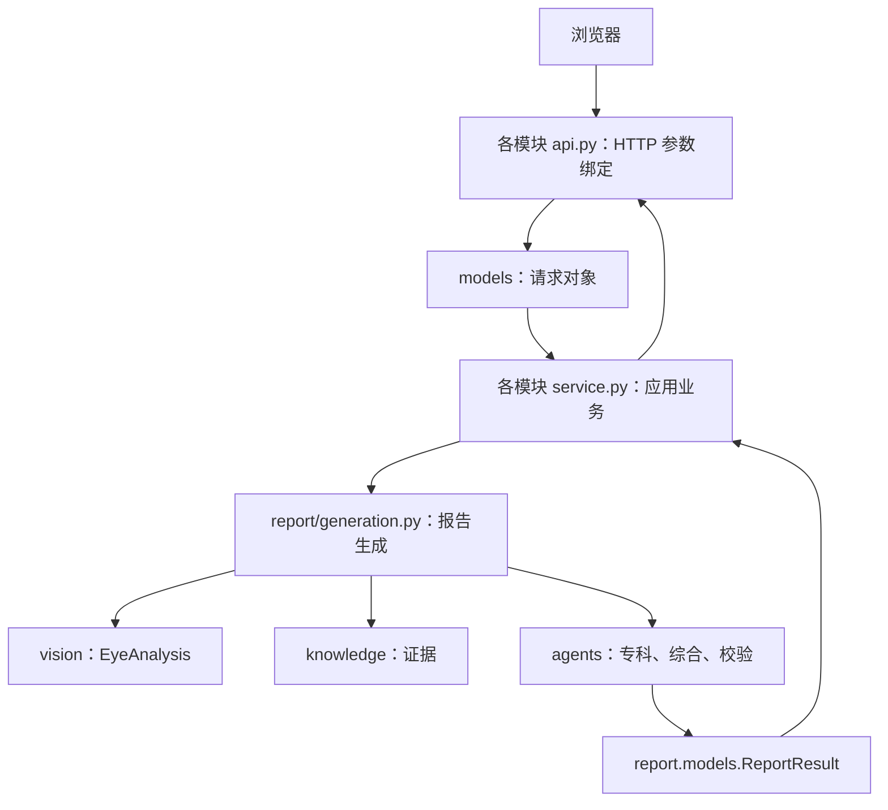

# 当前项目结构

以仓库当前实现为准。历史 ADR 和升级规格描述的是当时方案，不代表尚未实现的功能已经可用。

```text
backend/
  main.py                 FastAPI 组装、启动及静态页面托管
  各模块/models.py        该领域拥有的数据对象与接口类型
  user/api.py             用户 HTTP 路由
  user/service.py         账户、LLM 配置和用量业务
  chat/api.py             会话 HTTP 路由
  chat/service.py         会话、消息和问答业务
  report/api.py           上传参数绑定、报告/图片 HTTP 响应
  report/service.py       生成任务、记录保存和文件交付
  report/generation.py    影像分析、专科、综合与校验的生成流程
  report/context.py       组织病例事实
  report/pdf.py           PDF 渲染
  report/settings.py      有类型的展示标签与字体配置
  agents/                 专科分析、Director、Verifier 及工具
  agents/roles.py         唯一的专科角色与检索关键词定义
  vision/                 影像模型、测量和可视化
  knowledge/              检索与知识语料
  llm/                    模型请求和提示词配置
  utils/                  认证、配置、路径、持久化和应用错误
  tests/                  离线数值、Agent、路由和业务测试
frontend/                 React 界面与 HTTP 客户端
```

## 请求如何进入业务



## 上传参数的含义

`user: auth.CurrentUser` 由 Authorization 请求头中的 Bearer 令牌解析，客户端不能通过表单指定当前用户。`file` 是 multipart 的文件字段；`note` 和 `conversation_id` 是同一表单中的字符串字段。`parse_report_submission()` 将后三者组装成 ReportSubmission，通过 Depends 注入路由。路由仅接收 user 和 request 两个对象，再委托 report/service.py。

普通 JSON 请求使用 user/models.py、chat/models.py 中的 Pydantic 请求类。不能把上传文件直接改成普通 JSON 对象，否则会破坏现有 multipart 协议。

## 开发约定

- 每个领域的 api.py 只声明路由、HTTP 输入绑定和响应构造，不写模型推理、数据库操作和报告生成。
- service.py 接收已命名的数据对象，负责业务和资源生命周期；通过 ApplicationError 表达可预期错误，main.py 统一映射为 HTTP。
- 数据模型放在所属模块的 models.py。跨模块使用时直接导入拥有方，不复制定义。配置实例放在所属模块，例如 agents/roles.py、report/settings.py。
- 实现类留在业务模块；models.py 只保存数据契约，不保存执行逻辑。
- 公共接口标注参数与返回类型。异构 JSON 用 dict[str, Any]，已有明确结构时使用命名模型。
- 文件名体现实际职责：generation、context、retrieval、pdf、roles；不使用缺少含义的 workflow 或万能业务工具模块。
- utils 只收基础设施，领域工具放在领域内部的 tools/ 或 utils/。
- 前端 URL、multipart 字段和 JSON 字段保持兼容；重构后用路由和业务回归测试验证。

## 当前能力与限制

影像目前只实现青光眼模型，结果结构支持按病种扩展。专科 Agent 有受限的证据搜索/读取循环，Director 综合，Verifier 修订与复核。报告/PDF 的 CDR 和单张叠加图仍是当前展示约定，不表示其他病种已完成接入。前端业务交互本轮不变。
