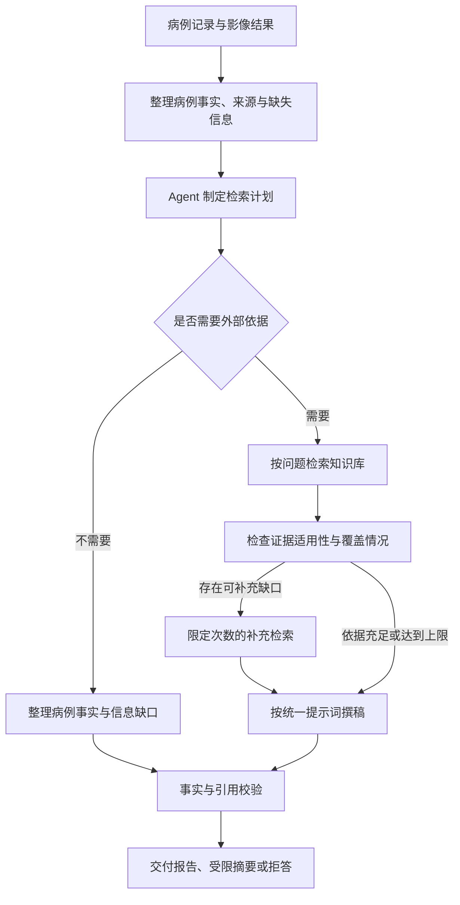

# 报告生成与语料库改造方案

日期：2026-11-26  
状态：第一版已实施（2026-11-26），实施落点见第 11 节。方案中的能力仍以实际代码与验收记录为准；引用校验不等于临床验证。

## 1. 目标与范围

将报告流程调整为：Agent 根据病例确定需要回答的问题，按需检索证据，按统一提示词生成报告，最后校验事实、结论和引用。

本次改造包含三个目标：

1. 由 Agent 决定是否检索，以及检索诊断依据、检查方法、鉴别诊断、处置或随访等哪些内容。
2. 以统一提示词约束报告结构、来源引用、表达方式和不确定性，并通过程序与 Verifier 校验。
3. 扩充诊断方法、诊断后建议等语料，建立来源、适用范围和审核状态可追溯的知识库。

第一版优先覆盖现有青光眼、糖尿病视网膜病变（DR）、年龄相关性黄斑变性（AMD）。知识库扩充其他病种，不代表影像模型获得相应诊断能力。报告仍仅供研究和开发参考，引用校验不能替代临床验证。

## 2. 当前实现与改造重点

方案以讨论时的工作区实现为基线，实施前应重新检查代码及已有未提交改动。

| 当前入口 | 当前行为 | 改造方向 |
| --- | --- | --- |
| `backend/modules/report/generation.py` | 影像分析后，逐病种检索，再进入撰稿和核查 | 引入病例整理、检索规划与受限补检 |
| `backend/modules/knowledge/report_focus.py` | 预设诊断、判读、治疗和随访主题 | 保留为主题词与回退策略，由病例决定选取哪些主题 |
| `backend/modules/agent/specialist.py` | 接收证据后一次成稿，不提供二次检索入口 | 保留撰稿职责，检索决策放在独立规划步骤 |
| `backend/modules/agent/prompts/report.py` | 专科和综合报告共用输出要求 | 统一初稿、综合与修订阶段的报告约束 |
| `backend/modules/agent/verifier.py` | 核查引用、修订并决定交付状态 | 继续核查，同时检查新增证据与病例适用性 |
| `backend/knowledge/corpus/` | 已有指南摘要、公众教育与示例材料 | 补齐主题覆盖，并让来源类型和审核状态参与筛选 |

核心变化是让病例决定检索问题，让证据约束报告内容。复用现有检索、专科、Director 和 Verifier，不为每个主题增加一个 Agent。

## 3. 建议生成流程



### 3.1 病例事实整理

输入按来源分开保存：用户提供的记录、已记载的诊断和检查、影像模型输出、缺失或冲突的信息。每条事实保留稳定标识、眼别及其原始来源位置。

整理过程不能把“未提供”改写成“未检查”，不能从单眼影像推断另一眼，也不能把模型分数改写为确诊、排除或分期。抽取结果必须能够回溯原始输入。

### 3.2 检索规划

新增检索规划 Agent，返回结构化计划，由代码验证字段并执行工具调用。

| 字段 | 用途 |
| --- | --- |
| `need_retrieval` | 是否需要新增检索 |
| `reason` | 简短、可审计的决策依据，不记录模型内部推理过程 |
| `questions` | 当前病例需要外部依据回答的问题列表 |
| `topic` | 问题所属主题：诊断、判读、检查、鉴别、处置、随访或教育 |
| `case_fact_ids` | 触发问题的病例事实标识 |
| `filters` | 病种、人群、诊疗阶段及来源类型等筛选条件 |
| `missing_information` | 影响判断但尚未提供的信息 |

其中 `topic`、`case_fact_ids`、`filters` 属于每个问题。对字段枚举、问题数量和可调用工具设置限制；病例文本和检索材料均作为数据，不得改变系统指令。

“检索诊断结果”分为两种用途：检索诊断标准支持当前病例评估；检索相似病例作为参考。相似病例的结论不能直接迁移为当前患者的诊断。

### 3.3 检索决策规则

| 情况 | 行为 |
| --- | --- |
| 仅整理用户提供的检查或既往诊断 | 可以不检索，保留用户提供的来源标记 |
| 解释检查结果、讨论诊断或鉴别诊断 | 检索相应标准与判读依据 |
| 提出检查、治疗、转诊或随访建议 | 检索建议及其适用前提 |
| 当前证据已覆盖问题且版本有效 | 复用证据，避免重复检索 |
| 缺少关键资料 | 明确缺口；必要时检索评估方法，不虚构结果 |
| 检索没有结果 | 记录知识缺口，收窄输出 |
| 检索工具故障 | 记录故障，与没有相关证据区分，不能伪装成成功检索 |

Agent 决定主题和查询方式，代码落实必要约束：新的医学解释与具体建议必须具备可核查依据。不检索只允许病例事实整理，或复用已经核对适用性和版本的证据；不允许用模型记忆替代出处。

### 3.4 检索执行与证据覆盖

第一版采用一次规划、一次批量检索、最多一次补检，并设置总查询数、总耗时、证据条数和模型调用预算。具体数值由评估集确定。

查询以问题主题和少量关键病例特征组合，避免将病例全文重复拼入所有查询，稀释主题。继续复用现有 BM25、向量或混合检索能力。

证据覆盖检查回答三个问题：是否回答了规划问题、是否适用于当前病例、来源类型是否足以支持拟写结论。缺失适用条件时不能默认满足；相互冲突的来源应保留版本和适用范围差异，不能简单合并成确定结论。

补检必须针对明确缺口，并真正访问语料索引。相同问题、查询和证据做去重，达到预算后明确保留缺口，不循环搜索。

所有参与最终报告的证据在请求内统一编号。补检新增证据采用追加编号，不重排已分配编号。保存证据正文或可复现快照、稳定 ID、来源版本和内容哈希，确保报告存档可复核。

## 4. 报告提示词与输出要求

### 4.1 统一结构

| 报告部分 | 内容要求 |
| --- | --- |
| 初步评估 | 按病种、眼别说明当前评估、不确定性；医学解释就地引用 |
| 关键依据 | 区分病例记录、影像模型结果与外部证据 |
| 诊断评估与待补信息 | 说明判断依据、尚缺前提及可考虑的检查目的 |
| 下一步建议 | 按病例提供有依据的处置、随访和教育建议 |
| 局限与核验状态 | 说明模型限制、证据缺口及来源审核状态 |

没有依据的部分允许明确写“当前无法给出”，不为填满章节生成诊疗内容。原始模型数值与完整来源清单继续由界面展示，正文避免重复堆叠。

### 4.2 核心提示词草案

```text
你是眼科研究报告撰写助手。仅依据提供的病例事实、影像分析结果和证据包生成报告。

1. 按“初步评估、关键依据、诊断评估与待补信息、下一步建议、局限与核验状态”组织报告。
2. 区分既往诊断、模型提示和本次初步评估；不得将模型分数转换为确诊、排除或分期。
3. 区分左右眼及来源；不得从单眼影像推断另一眼。
4. 每条医学解释和具体建议必须引用支持该表述且适用于当前情境的证据。
5. 病例事实引用其输入来源，不得以指南冒充患者的检查记录。
6. 每项建议说明目的和适用前提，区分已完成检查、未提供结果和待评估信息。
7. 不得为填满章节而编造诊断、检查数值、剂量、治疗方案、紧急程度或随访时间。
8. 资料不足时说明缺少什么，以及该缺口限制了什么判断。
9. 相似病例只能作为参考，不得替代当前病例的诊断依据。
10. 来源存在冲突、适用性不明或审核未完成时，保留相应限制，不写成确定结论。
11. 没有证据支持时收窄或省略建议，不用泛化检查清单替代病例分析。
12. 修订与综合时继续遵守以上要求，保留有依据的评估及下一步建议。
```

### 4.3 校验与交付

提示词之外，由程序检查结构和引用编号，由事实核查与 Verifier 检查来源支持、适用性、眼别一致性及编造数据。

保留现有有效报告、可标注交付、受限摘要、拒答和故障的语义；实施时明确映射现有状态契约，不能仅因有正文就判定成功。检索故障或核查失败不得作为有效报告交付。仅病例输入摘要不得伪装为通过核查的诊疗报告，也不能绕过 PDF 导出限制。

保存提示词版本、规划结果、检索状态、所用证据版本及核查结果。诊疗依据审核状态与引用核查状态分开记录，避免“引用有效”等同于“临床有效”。

## 5. 语料库扩充

### 5.1 按病种建立覆盖矩阵

先补齐青光眼、DR 和 AMD，再扩大其他病种的问答知识。

| 方面 | 收录内容 |
| --- | --- |
| 诊断与分型 | 诊断条件、分型分级依据、适用范围与限制 |
| 检查与判读 | 检查目的、适用场景、结果解释、局限及复查条件 |
| 鉴别诊断 | 易混淆表现、区分依据与需要补充的信息 |
| 诊断后处置 | 管理目标、治疗选择的条件及转诊依据 |
| 随访与监测 | 复查项目、间隔的适用前提及进展评估 |
| 患者教育 | 自我管理、依从性及症状变化后的求助指引 |
| 特殊情境 | 合并疾病、特殊人群与治疗前后的适用性差异 |

每个格子记录已有条款、缺口、来源核对状态和对应评估问题。不能仅凭文件名或数量判断覆盖完整。

### 5.2 按用途区分材料

- 指南与共识条款：支持诊断解释和处置建议，保留推荐条件与例外。
- 病例资料：保留表现、检查、诊断过程、处理及随访结局，用于参考和评估，不承担一般性推荐依据。
- 患者教育材料：支持通俗解释，不自动承担具体诊疗决策依据。

现有示例、草稿、公众教育和待复核材料应明确标记，不与已核对的正式条款等同使用。合成病例明确标注；真实病例入库前完成授权与去标识化。病例检索不得绕过账号或数据访问范围。

### 5.3 条款元数据

| 类别 | 建议字段 |
| --- | --- |
| 身份与版本 | 稳定 ID、版本、内容哈希、替代或撤回关系 |
| 出处 | 来源标题、链接、章节、发布日期、原文语言、访问及核对日期 |
| 分类 | 病种、主题、材料类型 |
| 适用性 | 人群、地区、诊疗阶段、前提条件、不适用条件 |
| 审核 | 原文核对状态、专业复核状态、审核记录 |
| 内容 | 原文或合规摘录、中文摘要、必要上下文 |

适用范围应逐步落实到条款层面，避免仅凭来源级病种登记筛选。新增字段需同步更新加载器、索引元数据、证据格式化和测试；兼容旧条款时将缺失状态明确表示为未知，不自动提升为已审核。

切分条款时保留推荐条件与例外，避免只留下脱离情境的建议。更新或删除条款后，使索引同步，并保留历史报告引用的证据快照。

### 5.4 入库流程

覆盖缺口清单 → 获取并核对原文 → 条款化整理 → 来源与适用性审核 → 去重与版本登记 → 入库及索引更新 → 检索回归。

以覆盖率、适用性和来源质量验收，不以文件数量验收。本方案不预先宣称任何外部指南为最新版本；实际扩库时核对发布机构原文、版本和使用条件。

## 6. 模块职责与兼容

| 模块 | 改动职责 |
| --- | --- |
| `modules/agent` | 检索规划、覆盖判断；复用专科、Director、Verifier |
| `modules/knowledge` | 对外提供按问题与适用条件检索的入口，封装去重、筛选和状态返回 |
| `modules/report` | 编排病例整理、规划、检索、补检、成稿与存档 |
| `agent/prompts` | 统一规划、初稿、综合及修订要求，维护版本 |
| 语料加载与索引 | 扩展条款元数据，支持旧数据迁移与来源追踪 |
| 前端与 PDF | 展示来源和核验状态，保持拒答与导出规则一致 |

跨模块复用走拥有方公开入口，不由 Agent 直接访问语料文件、数据库仓储或任意网络地址。保留现有认证、账号隔离、multipart 字段和响应字段；新增规划与检索记录采用兼容扩展。

第一版提供流程开关，保留旧流程用于比较和回退。是否复用现有图执行设施，以实施时工作区状态为准，不重复建设另一套 Agent 运行时。

## 7. 实施阶段

### 阶段一：覆盖与基线

- 盘点三病种语料覆盖、来源类型与审核状态。
- 建立病例评估集，记录应检索问题、适用证据和禁止生成的结论。
- 测量旧流程的检索覆盖、报告质量、模型调用次数及耗时。

交付物：语料缺口表、评估病例集、基线记录。

### 阶段二：按需检索与统一报告

- 实现结构化检索计划、程序约束、批量检索与一次补检。
- 统一报告提示词及版本管理。
- 接入现有核查、交付状态、证据编号和报告存档。
- 通过开关比较新旧流程。

交付物：可运行的新流程、离线回归、流程对比结果、相关模块说明。

### 阶段三：扩充正式语料与迭代

- 根据评估缺口优先补充诊断方法、处置和随访条款。
- 以正式核对材料替换可替代的示例内容。
- 验证条款适用性、来源冲突和历史版本可追溯性。
- 三病种流程稳定后，再扩展其他病种知识和相似病例检索。

交付物：版本化语料、覆盖矩阵、检索回归与来源审核记录。

## 8. 验收标准

| 维度 | 验收内容 |
| --- | --- |
| 检索决策 | 能区分病例复述与需要外部依据的解释或建议；应检索的问题不被静默跳过 |
| 病例针对性 | 查询由明确问题与关键病例特征触发，减少无关主题 |
| 证据适用性 | 病种、人群、阶段和前提条件不匹配时不能直接采用 |
| 引用完整性 | 无未知编号；医学解释与建议有对应支持，版本可追溯 |
| 事实忠实性 | 不编造检查结果，不混淆左右眼，不把未提供改成未检查 |
| 报告可用性 | 保留有依据的初步评估和下一步建议，不输出泛化清单 |
| 降级行为 | 区分无结果、工具故障与核查失败；受限摘要不冒充有效报告 |
| 工具预算 | 查询、补检和调用次数有上限，超限不形成循环 |
| 性能与成本 | 对比基线记录总耗时、检索次数、模型调用与 token 用量 |
| 语料质量 | 覆盖矩阵、来源核对和适用性记录完整，草稿不冒充正式条款 |

离线回归至少覆盖：不检索、正常检索、补检、无结果、工具故障、规划格式错误、预算耗尽、证据冲突、不适用来源、重复检查建议、多病种、左右眼混淆和未知引用编号。

先用固定工具结果验证流程与状态，再用经审核病例集评估真实模型输出。临床解释质量与建议适用性需要专业复核，不能仅由另一模型评分。量化阈值在基线形成后确定，不预先承诺准确率或性能提升。

## 9. 第一版交付范围

第一版交付按需检索 Agent、统一报告提示词、三病种语料覆盖补齐，以及全过程来源与校验记录。暂不包含自主处方、临床签发、未经审核的网络内容自动入库或新增病种视觉诊断能力。

## 10. 相关实现说明

- [项目 README](../README.md)
- [当前架构](ARCHITECTURE.md)
- [报告模块](../backend/modules/report/README.md)
- [Agent 模块](../backend/modules/agent/README.md)
- [知识检索模块](../backend/modules/knowledge/README.md)

本方案描述拟实施行为；当前能力与运行方式仍以项目 README、对应模块说明及实际代码为准。

## 11. 实施落点（2026-11-26）

| 方案要求 | 实施位置 |
| --- | --- |
| 病例事实整理 | `backend/modules/report/case_facts.py`：稳定 ID、眼别、原始位置、缺失与冲突；不把「未提供」写成「未检查」 |
| 检索规划与字段校验 | `backend/modules/agent/planner.py`、`prompts/planner.py`：JSON 计划、主题/数量/病种/来源类型校验、格式错误退回保守计划 |
| 按问题检索、覆盖、补检、预算、故障 | `backend/modules/knowledge/question_retrieval.py`：查询上限、耗时上限、证据上限、去重、一次补检、`tool_error` 与无结果分开 |
| 统一报告提示词与版本 | `backend/modules/agent/prompts/report.py`：`REPORT_PROMPT_VERSION=3`，五段结构与十二条约束，写入校验记录 |
| 核查新增适用性/眼别/编造数值 | `backend/modules/agent/tools/applicability.py`，接入 `verifier.py`；契约字段在 `contracts.py` |
| 检索与报告编排、流程开关 | `backend/modules/report/generation.py`（`generate_v2`）、`service.py`；`REPORT_PIPELINE=v2/legacy` |
| 条款元数据与兼容 | `backend/modules/knowledge/metadata.py`、`corpus.py`、`retrieval.py`：材料类型、审核状态、主题、适用条件、内容哈希 |
| 三病种语料扩充 | `knowledge/corpus/guidelines/{glaucoma,dr,amd}-care-pathway.json`，三病种既有来源补登元数据 |
| 覆盖矩阵与评估集 | `backend/tools/corpus_coverage.py` → [语料覆盖矩阵](语料覆盖矩阵.md)；[`backend/tests/fixtures/report_eval_cases.json`](../backend/tests/fixtures/report_eval_cases.json) |
| 基线与回归 | [报告流程基线](报告流程基线.md)；`backend/tests/test_report_pipeline_v2.py`、`test_corpus_metadata.py` |

已知未完成：相似病例检索、条款原文的专业复核、真实病例评估与量化阈值，均按方案留待后续阶段；当前 `review_status` 多为 `pending`，引用校验通过不等于临床审核通过。
