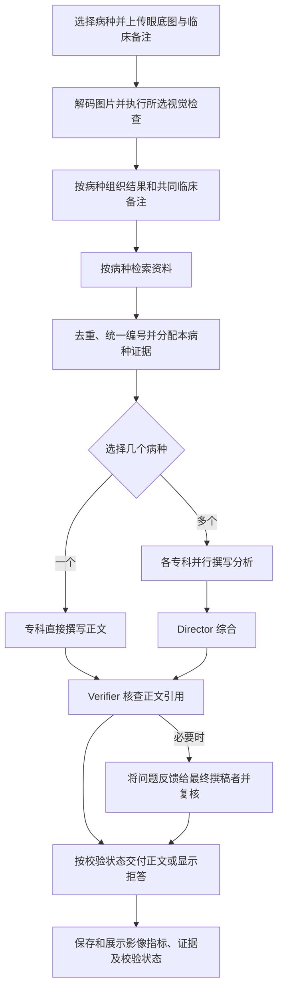

# 2026-11-19 v1 · 按病种检索与按需综合

## 更改了哪些

- **按病种分配病例信息和证据。** 整单共用一次检索改为每个所选病种各检索一次。专科接收本病种结果和资料，引用编号在整份报告内统一。
- **单病种由专科直接成稿。** 多病种继续并行撰稿，只在需要综合多份分析时运行 Director。
- **校验反馈回到最终撰稿者。** 单病种回到专科，多病种回到 Director，两条路径都复用已有的视觉结果和证据。
- **影像指标从正文中独立出来。** 数值、模型来源与告警来自结构化结果，在会话和历史 PDF 中单独展示。引用校验针对正文的外部知识陈述。
- **减少重复图像处理。** 图片在报告流程中解码一次。DR 与 AMD 同选时继续共享一次 FLAIR 图像编码。

对照起点为 [26.11.18 多病种业务基线](26-11-18.md)。

## 模块功能对照

| 模块 | 26.11.18 | 26.11.19 |
| --- | --- | --- |
| 病种选择与检查 | Python 根据勾选病种执行固定检查。上传校验与视觉模块分别解码图片。 | 同一处解码后执行所选检查。青光眼继续执行分类与视盘视杯分割，DR 和 AMD 继续按病种产出 FLAIR 差值。 |
| 专科输入 | 每个角色收到整份病例上下文，包含所有选中病种的结果。 | 各专科收到自己的视觉结果、模型提示和共同临床备注。其他病种的视觉结果交由综合阶段使用。 |
| 首轮检索 | 用整份病例描述查询一次，所有病种争用同一批召回位置。 | 每个病种依据自己的结果和共同备注检索。查询次数随所选病种数量增长，各病种拥有独立的召回机会。 |
| 证据分配 | 各专科收到同一份参考资料列表。 | 每个专科可以搜索和读取本病种召回的片段。相同片段按 ID 合并，跨病种引用沿用同一编号。Director 和 Verifier 接收整份证据。 |
| 证据覆盖 | 页面只看到整份报告的证据。单个病种没有相关资料时较难识别。 | 记录哪些病种没有召回资料。该病种的撰稿提示要求说明资料缺口，并把分析限定在病例所见和缺失信息。页面和 PDF 显示缺口。 |
| 单病种成稿 | 专科先写子报告，Director 再组织一次完整正文。 | 专科按最终报告格式撰稿并直接交给 Verifier。 |
| 多病种成稿 | 专科并发撰稿，Director 根据子报告和共享证据生成正文。 | 专科并发撰稿，Director 还收到病例上下文和病种证据分配。综合时按病种呈现发现，归并重复建议并保留分歧和缺失项。 |
| 校验与重生成 | 进入整篇重生成时统一交给 Director。 | 先对最终正文做引用核查和局部修订。确需整篇重生成时，单病种重新调用原专科，多病种重新调用 Director，随后复核。 |
| 页面和 PDF | 以生成正文为主，FLAIR 分数作为一段文字拼进正文。青光眼杯盘比和叠加图已有单独位置。 | 提供独立影像指标区，展示分类输出概率、面积等效杯盘比、FLAIR 差值、可用模型来源与告警。正文保留解读、缺失信息和引用。 |
| 持久化与兼容 | 保存正文、证据、校验状态及旧字段，例如杯盘比。 | 增加结构化病种结果。旧数据库启动时自动补字段。没有结构化结果的旧报告继续按原存档正文和旧杯盘比字段展示及导出。 |

## 业务流程

影像指标随分析结果独立保存。历史会话显示存档的报告和指标，历史 PDF 以该账号已保存的内容渲染。打开或导出历史报告不会再次运行视觉模型或调用撰稿 Agent。

## 典型场景与交付规则

| 场景 | 用户看到或触发的结果 |
| --- | --- |
| 只选青光眼 | 运行分类和分割，专科直接撰稿。页面分别显示原始指标和正文。整篇重生成时再次调用原专科。 |
| 同时选择 DR 和 AMD | 一次 FLAIR 图像编码返回两个病种的匹配分数。两个专科分别检索和撰写，Director 最终综合。 |
| 两个病种命中同一条资料 | 同一片段只保存一次。各专科在报告里引用同一个编号。 |
| 只有一个病种没查到证据 | 在该病种下标明未检索到资料。其他病种可以使用自己的资料，最终正文仍按整份证据核查。 |
| 整份报告没查到证据且引用校验开启 | 拒绝交付正文，允许查看本次状态与已算出的影像结果。 |
| 草稿里有不存在的引用编号 | 最终草稿进入校验和修订路径。关闭语义校验时，未知编号仍触发拒答。 |
| 图片损坏、无法判读或所选模型不可用 | 返回相应错误并中止整单。流程没有部分报告交付。 |
| 导出改造前的历史报告 | 使用已保存的正文、证据和旧指标字段。后补的结构化字段为空时继续正常导出。 |

## 验证和待评估项

- **已验证** 54 项后端离线测试通过，前端生产构建通过。覆盖单病种直接成稿、反馈重生成、混合病种证据及编号分配、个别病种证据缺口、旧库迁移与历史 PDF 指标恢复。
- **待评估** 用同一批病例和配置比较两版的病种级证据覆盖、引用支持度和报告耗时。当前测试覆盖业务行为，FLAIR 研究性匹配差值尚未做临床校准。

[报告业务说明](../backend/report/README.md) · [专科与引用校验](../backend/agents/README.md)
