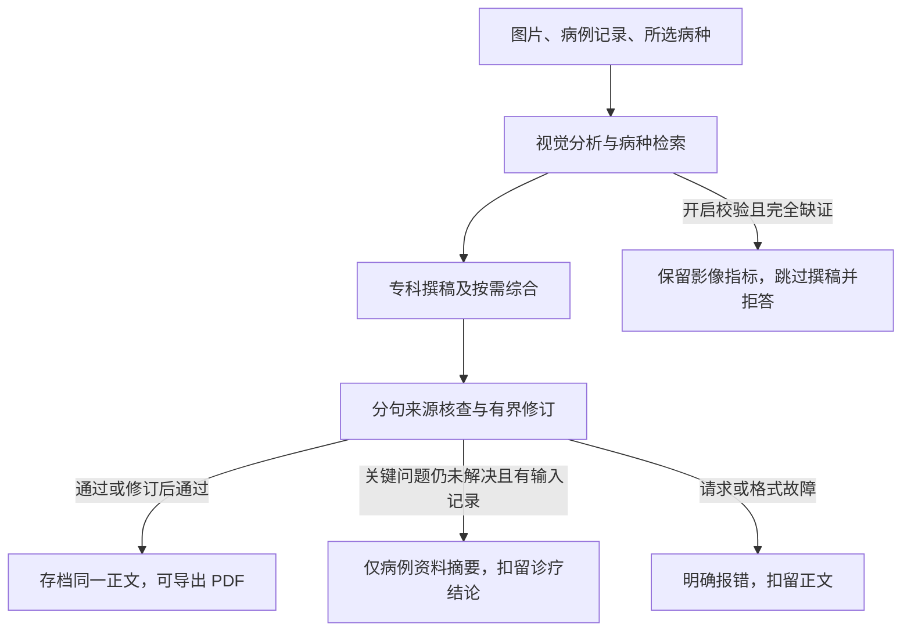

# 2026-11-25 · 眼科报告、证据核查与病例协作累计更新

## 更改了哪些

本期以 [11 月 18 日](26-11-18.md) 为起点，汇总 11 月 19 日至 25 日的提交和截至 25 日已实现的工作区改动。影像报告已从统一会诊改为按病种取证、撰稿和核查。已有分析可以导入逐眼病例，继续复核、模拟签发、转诊和随访。青光眼沿用冻结权重。当前业务演练使用合成病例。

### 本期变更与代码依据

| 时间 | 可观察的变化 | 实现依据 |
| --- | --- | --- |
| 11-19 第一轮 | 每个所选病种单独检索，按证据 ID 去重、全报告统一编号。选一个病种时对应专科直接成稿，选多个病种才并行撰稿并调用 Director。部分病种无证据时保留缺项；DR 与 AMD 联选共用一次 FLAIR 图像编码。分类概率、面积等效 CDR 和匹配差值独立于正文保存。 | [报告生成](../backend/report/generation.py) · [成稿分支](../backend/report/drafting.py) · [视网膜分析](../backend/vision/diseases/retinal.py) |
| 11-19 第二轮 | 上传端与后端统一接受 JPG、JPEG、PNG。启用校验且整单无证据时跳过撰稿，保留已有指标。叠加图按账号鉴权；报告及关联会话消息事务归档，失败时清理新增图像；下载已存报告从归档生成 PDF。无效校验响应不能放行正文。 | [归档与导出](../backend/report/service.py) · [事务](../backend/utils/storage.py) · [影像表单](../frontend/src/components/ReportView.jsx) |
| 11-20 第一轮 | 提问栏“+”接入影像分析，眼科问答可按会话保存图谱开关。新增 4 个指南来源、9 条摘要。基础检索可直接读取独立指南；BM25 使用倒排索引，E5 按版本与文本缓存向量。文本、图谱结果共同参与 RRF，图谱异常时保留文本结果，重复条款 ID 在建索引时报告。 | [检索](../backend/knowledge/retrieval.py) · [向量缓存](../backend/knowledge/vector_cache.py) · [图谱构建](../backend/graphrag/builder.py) |
| 11-20 第二轮及 11-21 | 分割图可在指标旁展开，历史证据卡片按消息内引用编号定位。4 个合成青光眼回放覆盖面积等效 CDR、分割缺项、无证据和无效校验。新增 34 个 NEI 公众教育主题；输入栏“+”保留 36 × 36 像素点击区，分割预览上限为 320 × 280 像素。 | [回放用例](../backend/tests/test_glaucoma_cases.py) · [语料](../backend/knowledge/corpus/guidelines/) · [会话界面](../frontend/src/components/ChatView.jsx) · [样式](../frontend/src/styles.css) |
| 11-25 报告核查 | 病种重点词进入检索。策略 v2 将分句、证据片段、病例输入和修订轮次关联。可安全定位的非核心问题可删除后复核。符合条件时仅交付原始病例资料摘要，两个诊断 PDF 入口都阻止摘要导出。 | [病种重点词](../backend/knowledge/report_focus.py) · [分句核查](../backend/agents/tools/grounding.py) · [摘要触发条件](../backend/report/source_summary.py) |
| 11-25 病例协作 | 可选择一至两份归档报告，核对眼别和采集缺项，预览后生成新草稿。青光眼、DR、DME、AMD 分眼人工记录；DME 可判读结论须有同眼 OCT 才能模拟签发。支持急症交接提示、撤销签发、按签发版登记随访、转诊接单及到诊回执、逾期筛选。白内障和干眼提供检查导航。 | [导入](../backend/screening/imports.py) · [状态与签发](../backend/screening/service.py) · [导航](../frontend/src/components/screening/ExamGuide.jsx) · [跟进筛选](../frontend/src/screening/followup.js) |
| 11-25 机构与运行维护 | 机构采集、阅片和协调角色分工；原图和叠加图可按病例版本调阅。报告页提交持久化任务，按号轮询，重复键校验内容，重启后继续消费。可限制机构模型端点、暂停分析、定期清理到期原图、停写备份和校验恢复。 | [权限](../backend/screening/access.py) · [影像调阅](../backend/screening/api.py) · [任务队列](../backend/report/queue.py) · [归档维护](../tools/archive_maintenance.py) |
| 11-25 基线与评估 | 青光眼分类和分割固定到提交版本，记录处理器和权重哈希。四病种合成样例可验证患者分组、弃判、漏转及抽样核验计算；机构运营工具可统计任务等待、端到端 P95、转诊到诊人数和模拟签发成本。 | [冻结清单和样本输出](../docs/baselines/) · [配对评估](../backend/screening/evaluation.py) · [运营统计](../tools/screening_operations.py) |

### 本期汇报中的数字

对应的 [11 月 25 日汇报 PPT](<../ppt/OcuPanel 项目汇_26.11.25.pptx>) 在 11 月 19 日版上更新，括号内为上期汇报值或做法。

外部 LLM 仍由账号在个人设置填写 API Key、Base URL 和模型，配置按用户保存。加入机构的账号在保存、读取和测试连接时增加获准端点校验；普通个人账号不触发机构端点检查。PPT 四层结构中的“新增机构端点校验”指这一条件约束。[账号配置](../backend/user/service.py) · [按用户存取配置](../backend/utils/storage.py) · [机构端点检查](../backend/screening/access.py)

| 指标 | 11-25 核查结果 | 上期 PPT 及可比范围 |
| --- | --- | --- |
| 后端测试 | 当前工作区完整离线运行 **158 项通过**。前端另有 **10 项工作台回归通过**，Vite 生产构建通过。 | 11-19 PPT 为 52 项后端测试。此前来源核查的 105 项是专项记录，病例升级的 109 项是当时全量记录，均与本轮有重叠。 |
| 图谱 | 按构建器输入清点 1 份主图谱及 38 份独立指南，共 **100 个概念、71 条概念关系、50 个来源、120 条条款**。其中 34 个 NEI 主题贡献 68 个概念、55 条关系、34 个来源及 93 条条款。 | 上期为 24、16、12、18，仅主图谱。关系数按语料中的概念关系计，不含指向条款的锚点边。 |
| 同一合成眼底图 | 冻结基线回放记录分类概率 **0.99996**、面积等效 CDR **0.8485**、掩膜 **1024 × 1024**、CPU 耗时 **4.69 秒**。 | 上期记录前三项相同，耗时约 10.7 秒（含加载）。两次加载条件未统一，不能据此计算加速比。本次汇总读取已保存的回放记录。 |
| SQLite | 当前全新主应用库建表 **14 张**，包括报告任务和 7 张病例／机构表。统计采用业务存储、会话令牌与病例模块的建表定义，不含向量缓存或 SQLite 内部表。 | 上期 PPT 记载 8 张。该数字是上次汇报值；旧部署的实际表数取决于历史迁移。 |

**演练路径。** 上传报告后凭任务号查看结果；符合导出条件的诊疗报告可生成 PDF。导入病例时先确认眼别及原图，缺图会阻止原图复核。模拟签发后，转诊单和随访都可追溯到签发版，撤销后保留历史。尚待合作机构落实真实病例授权、独立专科验证、正式签发和生产环境恢复演练。[升级验收](../docs/升级验收.md) · [试点准备表](../docs/试点准备表.md)

### 11-25 来源核查专项

报告结果分为通过、修订后通过、仅病例资料摘要，以及校验故障等状态。未完成核查的诊疗结论继续扣留，病例资料和结构化影像结果可分别保留。

## 业务模块的前后对照

| 环节 | 调整前的问题 | 本次行为 |
| --- | --- | --- |
| 病种检索 | 完整病历中的通用检查名和否定病史可能召回无关病种条款；已有查询词未获得预期加权 | 为所选病种传入检索侧重点。BM25 对已在查询中的重点词仍加权；向量查询把病种提示放在长病例前，减少截断影响 |
| 来源核查 | 校验器主要看到生成正文与证据，可能要求指南证明本例测量值，或要求文献逐字描述患者组合 | 将原始病例记录与结构化视觉结果送入核查、修订。区分病例事实、医学知识、病例推理、一般建议、具体处置、软件能力边界及资料范围限制 |
| 判断尺度 | 同义表述、普通下一步与新增医学结论可能混在一起被拒绝 | 按语义支持核查。病例解释可由病例与通用诊断要素共同支持；确定性诊断、排除、分期及具体检查、剂量、周期仍需相应依据。来源归类争议先有界复核 |
| 定点修订 | 混合句整句被质疑，按句首模糊定位可能错位；相同内容也可能计作改写 | 仅修改本轮点名的完整分句，保护可直接匹配的病例片段。容忍空白和成对 Markdown 标记差异，禁止按句首猜测位置。相同内容不计修复 |
| 局部问题 | 非核心说明反复改写后仍可能导致整篇拒答 | 仅剩可安全定位的非核心说明时，尝试一次局部删除，再核查全文；保留原句和原因。核心问题、未知编号及复核失败继续阻断诊疗正文 |
| 错误提示 | 模型请求或返回结构错误被笼统描述为缺少依据，并提示补检查 | 区分无证据、仍有未支持表述、空响应、模型请求失败、JSON 或条目结构错误。格式错误带反馈重试一次，不能把无效响应当作通过 |

病种侧重点只影响召回，不代表患者确诊，也不替代指南地区、场景及条件的适用性核查。本次没有新增医学语料或修改已有条款的来源。

## 来源对照与审计

新报告使用 `policy_version=2`。核查同时返回问题列表和 `grounding` 来源对照：记录已接受的分句、来源类别、引用编号、支持片段及解释。

- 正文位置通过本轮 `statement_id` 关联真实分句，减少模型回抄改词造成的误拒。
- 外部证据核对编号与原文片段；病例和软件声明可通过固定标识关联真实输入或声明快照，不把模型转述当作原文。
- 每个正文引用位置均需来源关联。未知编号、负编号及组合或范围写法不能绕过编号检查。
- 来源对照不足进入修订路径；归类争议在修改正文前最多复核一次。格式重试、正文修订和整篇重生成均有上限。

`source_manifest` 保存病例上下文快照、证据 ID/章节及内容哈希；`review_log` 记录核查阶段、正文版本和问题；`fixed` 保存实际删改；最终正文保留版本哈希与编号关联。重生成失败时保留已有问题和审计记录。

代码检查来源片段及位置的存在性，语义支持、来源归类和医学适用性仍依赖模型。来源校验通过不等于临床准确度验证或医生签发。

## 端到端流程与交付分支

用户提交图片、病例记录和病种后，系统运行视觉分析，按病种检索并统一编号，再由专科撰稿；多病种仍由 Director 综合。校验与修订使用同一份病例上下文和证据。

`limited` 病例资料摘要只保留用户输入原文，明确未独立核验，不混入失败诊疗草稿；结构化影像结果另行展示。该状态保存 `diagnostic_status=rejected` 和 `rejected=true`，两个诊断 PDF 入口均阻断。故障、无证据或没有输入记录不会转换为通过状态。

聊天中的校验面板可展开支持片段、删改原因和每轮问题数量。通过报告的聊天消息、存档及 PDF 使用同一正文；摘要不会显示为通过报告。旧报告保留原正文和保存时的校验记录，不自动升级或重写。更新后需重启后端再生成；前端生产构建已完成。

## 验证范围与限制

来源核查专项当时记录 **105 项相关离线回归通过**，覆盖来源片段及引用位置、混合句修订、病例事实保护、无效改写、故障分类、未知编号、局部删除后复核、受限摘要、账号隔离、存档/会话/PDF 一致性，以及病种检索和图谱回退。前端生产构建通过；另检查了摘要中原始记录保持字面文本，不执行其中的 HTML。

真实模型回放结果：

| 场景 | 结果 |
| --- | --- |
| 左眼检查事实，加由接诊医生决定复查安排的一般性建议 | 通过 |
| 仅凭右眼照片确诊双眼重度青光眼并给出具体剂量 | 拦截，未交付 |
| Sample 全篇撰稿与来源核查 | 使用实际 BM25 病种检索，修订后通过，保存 9 条来源对照 |

Sample 全篇回放使用当前示例记录，并复用经图片哈希确认属于同一示例图的已存视觉结果，未重新运行视觉模型。检索取得中国青光眼指南、NICE 青光眼诊断评估及相关筛查条款，未混入 DME 条款。回放中的撰稿与核查调用真实模型；这次结果不保证重复生成的措辞或通过状态完全一致。

真实回放包含接口连接波动及未通过的草稿；这些路径分别检查故障处理或受限摘要，不作为通过报告。未完成真实病例临床效能验证，也未以本轮 BM25 回放代替真实向量通道及所有病种的端到端验证。

## 相关说明

- [报告流程与交付状态](../backend/report/README.md)
- [来源与分句校验](../backend/agents/README.md)
- [知识检索](../backend/knowledge/README.md)
- [回归测试范围](../backend/tests/README.md)
- [前端校验面板](../frontend/README.md)
