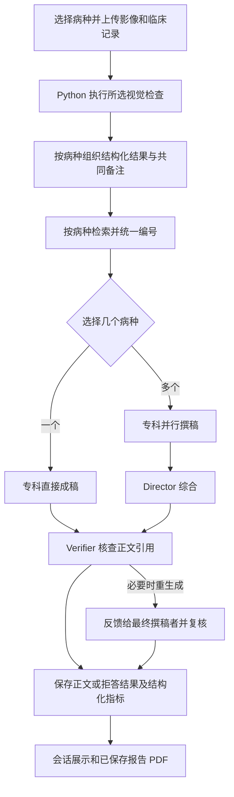

# 2026-11-19 · 按病种撰稿与按需综合

## 更改了哪些

- Python 按所选病种执行必需的影像检查，报告入口共用一次图像解码。DR 和 AMD 同时选择时共用一次 FLAIR 图像编码。
- 按病种检索并分配证据，整份报告按片段 ID 去重、统一编号，并标出未命中资料的病种。
- 单病种由专科直接成稿。多病种并行撰稿后由 Director 综合。校验要求整篇重写时，反馈回到最终撰稿者。
- 结构化保存影像指标、模型来源和告警。页面及历史 PDF 使用同一套展示格式，正文引用校验有独立状态。

## 业务板块

| 板块 | 业务规则 |
| --- | --- |
| 病种与视觉工具 | 青光眼固定执行分类和视盘视杯分割。DR、AMD 使用 FLAIR 按病种计算匹配差值。所选病种检查失败时中止整单。 |
| 证据与专科 | 每个专科收到本病种视觉结果、共同临床记录及其召回的资料。各病种命中相同片段时共用引用编号。专科对证据不足的病种应说明缺口。 |
| 撰稿与校验 | 单病种由专科负责最终草稿及重生成。多病种由 Director 负责综合及重生成。Verifier 负责外部知识陈述的引用核查，结果决定正文是否交付。 |
| 展示与留痕 | 影像指标区展示模型结果、来源和告警。页面和 PDF 分别展示指标与正文。SQLite 自动补充字段，旧报告可以继续导出。 |

## 业务流程

首轮检索按病种执行，具体病例上能否提高证据覆盖率、引用支持度和生成速度仍需真实模型对照。FLAIR 差值为研究性模型输出。

## 验证

后端 54 项离线测试通过，前端生产构建通过。测试覆盖单病种直接成稿、重生成反馈、混合病种证据去重、单病种证据缺口、旧库迁移及历史 PDF 指标恢复。

实现见 [报告模块](../backend/report/README.md) 和 [专科与校验](../backend/agents/README.md)。
